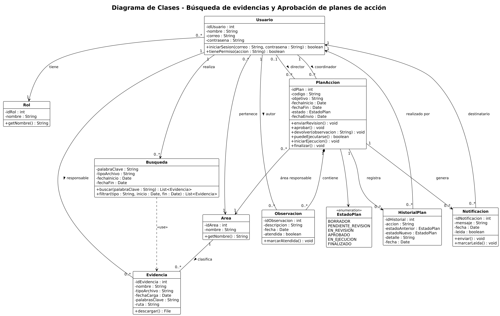
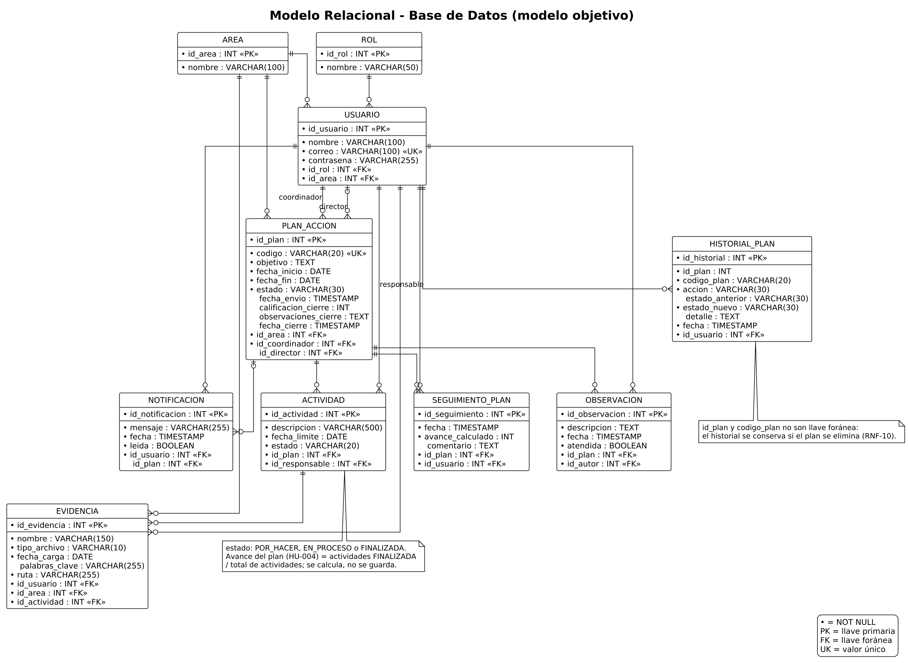
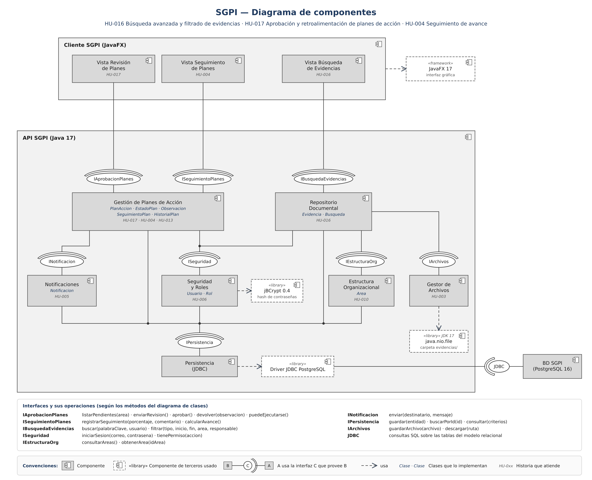
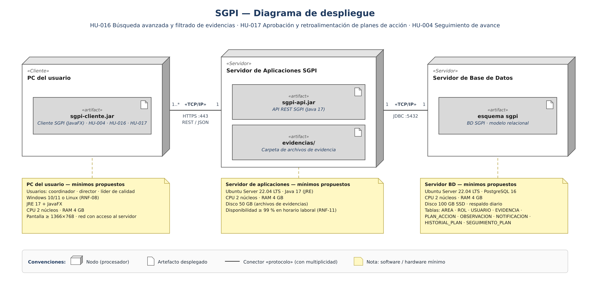
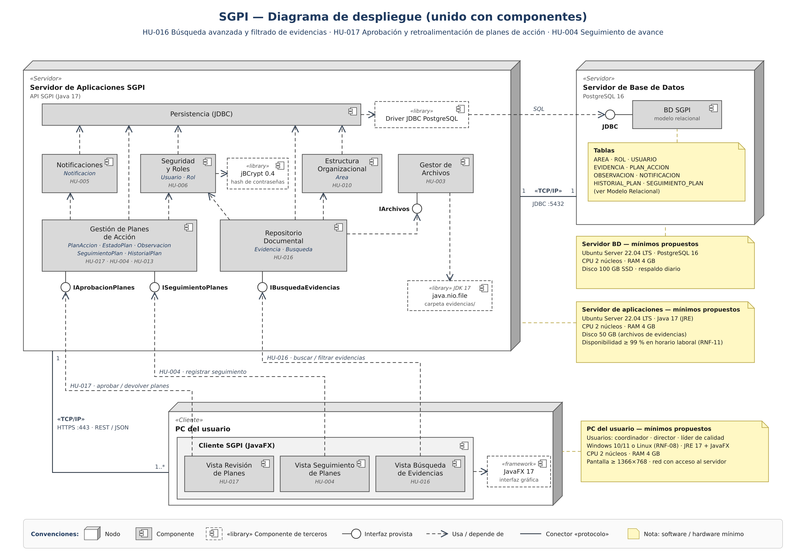
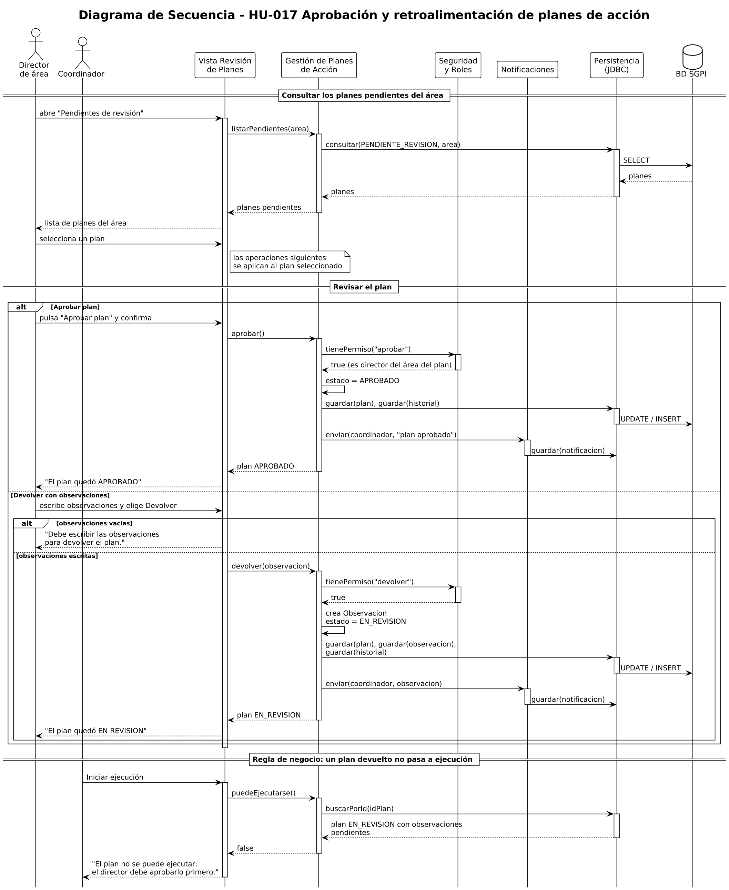
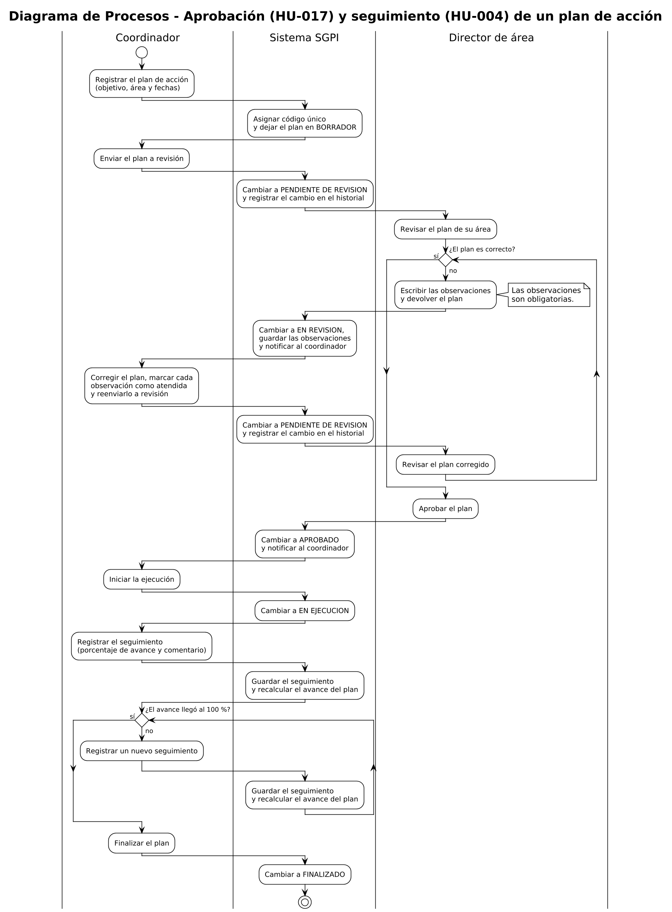

# Arquitectura del SGPI — Diseño de HU-016 y HU-017

Diagramas de diseño para los dos casos de uso elegidos en el ejercicio de la Sesión 15 (Análisis y diseño de software):

- **HU-016** — Búsqueda avanzada y filtrado de evidencias (líder de calidad).
- **HU-017** — Aprobación y retroalimentación de planes de acción (director de área).

Desde la revisión con el profesor del 16 de octubre, los diagramas también incluyen el seguimiento del plan de acción (**HU-004**, seguimiento de avance).

Todos los diagramas están en PNG en la carpeta [`/Graficas`](../../Graficas). Los de clases, modelo relacional, secuencia y procesos tienen su fuente editable en PlantUML (`.puml`) en [`Graficas/fuentes`](../../Graficas/fuentes).

## 1. Diagrama de clases



- Clases del dominio: `Usuario`, `Rol`, `Area`, `Busqueda`, `Evidencia`, `PlanAccion`, `EstadoPlan` (enumeración), `Observacion`, `Notificacion`, `HistorialPlan` y `SeguimientoPlan`.
- Un `Usuario` tiene un `Rol` y pertenece a un `Area`. Es responsable de evidencias, coordina o dirige planes de acción, escribe observaciones, registra seguimientos y recibe notificaciones.
- `PlanAccion` es el centro de HU-017:
  - Pertenece a un área, que es la que revisa su director.
  - Contiene sus `Observacion` (composición: una observación no existe sin su plan).
  - Genera `Notificacion` para el coordinador.
  - Registra cada cambio de estado en `HistorialPlan` (RNF-10).
  - Contiene sus `SeguimientoPlan` (composición), que registran el avance durante la ejecución (HU-004).
  - Sus métodos siguen el flujo de la HU: `enviarRevision()`, `aprobar()`, `devolver(observacion)`, `iniciarEjecucion()`, `registrarSeguimiento(porcentaje, comentario)` y `finalizar()`. `puedeEjecutarse()` aplica la regla de negocio: un plan devuelto no pasa a ejecución hasta que sus observaciones queden atendidas y el director lo apruebe de nuevo. `calcularAvance()` da el avance del plan a partir de sus seguimientos.
- `EstadoPlan` tiene los estados del ciclo de vida: `BORRADOR` → `PENDIENTE_REVISION` → `APROBADO` o `EN_REVISION` (devuelto) → `EN_EJECUCION` → `FINALIZADO`. Su atributo `estado` es el texto que se muestra y se guarda en la base de datos (por ejemplo, `PENDIENTE_REVISION` se guarda como "PENDIENTE DE REVISION"), y `esEditable()` indica si el coordinador puede modificar el plan (solo en `BORRADOR` o `EN_REVISION`).
- `SeguimientoPlan` guarda la fecha, el porcentaje de avance y un comentario. Lo registra un `Usuario` y puede estar respaldado por evidencias.
- `HistorialPlan` y `SeguimientoPlan` son distintos: el historial lo escribe el sistema en cada cambio de estado (auditoría); el seguimiento lo registra una persona para reportar el avance.
- `Busqueda` depende de `Usuario` («use»): `buscar(palabraClave, usuario)` recibe a quien busca, porque los resultados dependen de sus permisos y de su área. También usa `Evidencia` («use») para buscar y filtrar, pero no la guarda. `filtrar()` recibe tipo, fechas, área y responsable, como pide HU-016. Cada `Evidencia` está clasificada en un `Area`.

## 2. Modelo relacional de la base de datos



- Nueve tablas: `AREA`, `ROL`, `USUARIO`, `EVIDENCIA`, `PLAN_ACCION`, `OBSERVACION`, `NOTIFICACION`, `HISTORIAL_PLAN` y `SEGUIMIENTO_PLAN`. Cada clase del diagrama es una tabla, salvo `Busqueda`, que no se guarda, y `EstadoPlan`, que es la columna `estado` (`VARCHAR(30)`, porque guarda el texto del estado; "PENDIENTE DE REVISION" tiene 21 caracteres).
- `USUARIO` referencia a `ROL` y `AREA`; `correo` es único porque con él se inicia sesión.
- `PLAN_ACCION` referencia a su área y dos veces a `USUARIO`: al coordinador y al director. `codigo` es único. `id_director` y `fecha_envio` quedan vacíos mientras el plan no se ha enviado ni revisado.
- `OBSERVACION` referencia al plan y a su autor. `NOTIFICACION` referencia al destinatario y, cuando el aviso es de un plan, al plan. `HISTORIAL_PLAN` referencia al plan y al usuario que hizo el cambio.
- `SEGUIMIENTO_PLAN` referencia al plan y al usuario que registró el avance. `EVIDENCIA` puede referenciar el seguimiento que respalda (`id_seguimiento` puede quedar vacío).
- Las fechas con hora son `TIMESTAMP`, el tipo de PostgreSQL, que es la base de datos del diagrama de despliegue.

El prototipo de la Entrega 2 implementa la parte de HU-017 de este modelo en H2, con cinco tablas: el rol y el área quedan como texto en `usuarios`, y no hay tabla de evidencias porque HU-016 no está programada. Ver [`Database/prototipo-h2.sql`](../../Database/prototipo-h2.sql).

### Cambios frente a la primera versión

| Cambio | Motivo |
|---|---|
| `EstadoPlan` incluye `BORRADOR` y `FINALIZADO` | Todo plan nace en borrador (CU-01) y el ciclo termina en finalizado, como en el prototipo |
| Nueva clase `HistorialPlan` y tabla `HISTORIAL_PLAN` | RNF-10: cada cambio de estado queda con el valor anterior y el nuevo |
| `PlanAccion` tiene `codigo`, `objetivo`, `fechaInicio` y `fechaFin`, y se asocia con su `Area` | Son los datos del formulario de CU-01, y el director revisa los planes de su área |
| Dos relaciones entre `USUARIO` y `PLAN_ACCION` (coordinador y director) | La tabla tiene dos llaves foráneas a `USUARIO`; antes se dibujaba una sola línea |
| Asociación `autor` entre `Usuario` y `Observacion`, y atributo `leida` en `Notificacion` | Ya estaban en el modelo relacional y faltaban en el de clases |
| El director de un plan es `0..1`; `id_director` y `fecha_envio` pueden ser nulos | Un plan en borrador todavía no tiene director ni fecha de envío |
| Un rol o un área pueden tener `0..*` usuarios | Coincide con el modelo relacional |
| `DATETIME` cambia a `TIMESTAMP` | `DATETIME` es de MySQL; el despliegue usa PostgreSQL 16 |

### Correcciones de la revisión con el profesor (16 de octubre)

| Diagrama | Observación | Cambio |
|---|---|---|
| Clases | `EstadoPlan` debe tener un atributo `estado` | `EstadoPlan` tiene el atributo `estado` y los métodos `getEstado()` y `esEditable()` |
| Clases | La búsqueda debe depender del usuario | La asociación `Usuario`–`Busqueda` pasa a ser una dependencia «use» de `Busqueda` hacia `Usuario`; `buscar()` recibe el usuario |
| Clases | Integrar un seguimiento del plan de acción | Nueva clase `SeguimientoPlan` (HU-004), métodos `registrarSeguimiento()` y `calcularAvance()` en `PlanAccion`, y tabla `SEGUIMIENTO_PLAN` |
| Componentes | No poner "Almacén de Archivos", sino el componente específico | El componente **Gestor de Archivos** de la API provee `IArchivos` y usa `java.nio.file` para guardar los archivos en la carpeta `evidencias/` del servidor |
| Componentes | Especificar los componentes usados | Se agregan los componentes de terceros que usa cada componente: JavaFX 17, jBCrypt 0.4, el driver JDBC de PostgreSQL y `java.nio.file` |
| Despliegue | Sin cambios pedidos | Solo se actualizaron la lista de tablas, las HU del cliente y los usuarios de la nota, para que coincidan con los demás diagramas |
| Procesos | La decisión va del lado del "no" y las decisiones deben ser rombos | Las decisiones son rombos; el ciclo de devolución sale por el "no" y vuelve a la decisión; se agregó el seguimiento hasta el 100 % antes de finalizar |

En la misma revisión se corrigieron cuatro diferencias entre diagramas: faltaba `HISTORIAL_PLAN` en las tablas del despliegue y `HistorialPlan` en el componente Gestión de Planes; `listarPendientes(area)`, que usa el diagrama de secuencia, no estaba en `IAprobacionPlanes`; y `filtrar()` tenía menos parámetros en el diagrama de clases que en la interfaz. Además, la columna `estado` pasó de `VARCHAR(20)` a `VARCHAR(30)`.

## 3. Diagrama de componentes



- Notación de la Sesión 15: componente con ícono, interfaz provista (bola) e interfaz requerida (media luna).
- Cliente SGPI (JavaFX) con tres vistas: Revisión de Planes (HU-017), Seguimiento de Planes (HU-004) y Búsqueda de Evidencias (HU-016).
- API SGPI (Java 17) con Gestión de Planes de Acción, Repositorio Documental, Notificaciones, Seguridad y Roles, Estructura Organizacional, Gestor de Archivos y Persistencia.
- Cada componente indica las clases del diagrama de clases que lo implementan y la historia de usuario que atiende.
- Los componentes de terceros («library» o «framework», con borde punteado) son los que usa cada componente: JavaFX 17 en el cliente, jBCrypt 0.4 en Seguridad y Roles (hash de contraseñas, RNF-03), el driver JDBC de PostgreSQL en Persistencia y `java.nio.file` del JDK en el Gestor de Archivos, que guarda los archivos en la carpeta `evidencias/` del servidor.
- El recuadro inferior define las operaciones de cada interfaz a partir de los métodos del diagrama de clases.

## 4. Diagrama de despliegue



- Tres nodos: «Cliente» PC del usuario, «Servidor» de aplicaciones y «Servidor» de base de datos.
- Artefactos desplegados en cada nodo (incluida la carpeta `evidencias/`, donde el Gestor de Archivos guarda los archivos) y conectores «TCP/IP» con su protocolo (HTTPS y JDBC) y multiplicidad.
- Notas con las propiedades mínimas de software y hardware de cada nodo.

## 5. Diagrama de despliegue unido con componentes



Mismos nodos y conectores del punto 4, con los componentes del punto 3, incluidos los de terceros, ubicados dentro del nodo donde se ejecutan (formato de la diapositiva "Uniendo diagrama de despliegue con componentes").

## 6. Diagrama de secuencia (HU-017)



- Participantes: el director de área, el coordinador y los componentes del punto 3 que intervienen en HU-017: Vista Revisión de Planes, Gestión de Planes de Acción, Seguridad y Roles, Notificaciones, Persistencia y BD SGPI.
- Los mensajes son las operaciones de las interfaces del punto 3 y los métodos del diagrama de clases: `aprobar()`, `devolver(observacion)`, `puedeEjecutarse()`, `tienePermiso(accion)`, `enviar(destinatario, mensaje)`, `guardar(entidad)`, `consultar(criterios)` y `buscarPorId(id)`. `listarPendientes(area)` es la operación de `IAprobacionPlanes` con la que la vista del director carga los planes de su área.
- Tiene tres partes:
  - El director consulta los planes pendientes de su área.
  - Revisa un plan: el bloque `alt` separa aprobar de devolver. Dentro de devolver, otro `alt` muestra que con las observaciones vacías la vista muestra el error y no llama a Gestión de Planes.
  - La regla de negocio: si el coordinador intenta ejecutar un plan devuelto, `puedeEjecutarse()` responde `false`.

## 7. Diagrama de procesos (HU-017 y HU-004)



- Diagrama de actividades con tres carriles: Coordinador, Sistema SGPI y Director de área. Las decisiones son rombos.
- Sigue el ciclo de vida del plan: BORRADOR → PENDIENTE DE REVISION → APROBADO → EN EJECUCION → FINALIZADO.
- Decisión "¿El plan es correcto?": por el "no" el director devuelve el plan con observaciones obligatorias, el sistema lo deja EN REVISION y notifica, y el coordinador lo corrige, marca las observaciones como atendidas y lo reenvía. El director lo revisa otra vez y se vuelve a la decisión. Por el "sí", el director lo aprueba. Así no hay forma de llegar a la ejecución sin aprobación.
- Decisión "¿El avance llegó al 100 %?": durante la ejecución, el coordinador registra seguimientos y el sistema recalcula el avance (HU-004). Por el "no" se registra otro seguimiento; por el "sí" el coordinador finaliza el plan.
- Un plan devuelto queda EN REVISION, como dice HU-017. El CU-01 dice "En borrador"; esa diferencia está pendiente de decisión del equipo.

## Supuestos pendientes de confirmar por el equipo

| Tema | Supuesto usado en los diagramas | Fuente |
|---|---|---|
| Cliente | Aplicación de escritorio JavaFX sobre JRE 17 | Propuesta, RNF-06 y RNF-08 |
| Comunicación cliente–servidor | API REST sobre HTTPS (puerto 443) | Propuesto en estos diagramas; no definido en otro documento |
| Base de datos | PostgreSQL 16, acceso por JDBC (puerto 5432) | RNF-09 (PostgreSQL o MySQL) |
| Hardware mínimo | 2 núcleos, 4 GB de RAM, discos de 50 GB (aplicaciones) y 100 GB (BD) | Propuesto en estos diagramas; no definido en otro documento |
| Filtro de evidencias | `filtrar(tipo, inicio, fin, area, responsable)` | HU-016 (filtrar por tipo, fecha, área o responsable) |

Si el equipo decide una aplicación web o MySQL, hay que actualizar los diagramas. Están pendientes de la revisión técnica del líder técnico.

## Cómo regenerar las imágenes desde las fuentes

Las fuentes de los diagramas de clases, modelo relacional, secuencia y procesos están en [`Graficas/fuentes`](../../Graficas/fuentes). Se abren en cualquier editor de PlantUML (por ejemplo, la extensión de PlantUML de VS Code o el servidor web de PlantUML), o se generan las imágenes desde la carpeta `Graficas` con:

```
java -jar plantuml.jar -tpng -o .. fuentes/*.puml
```
