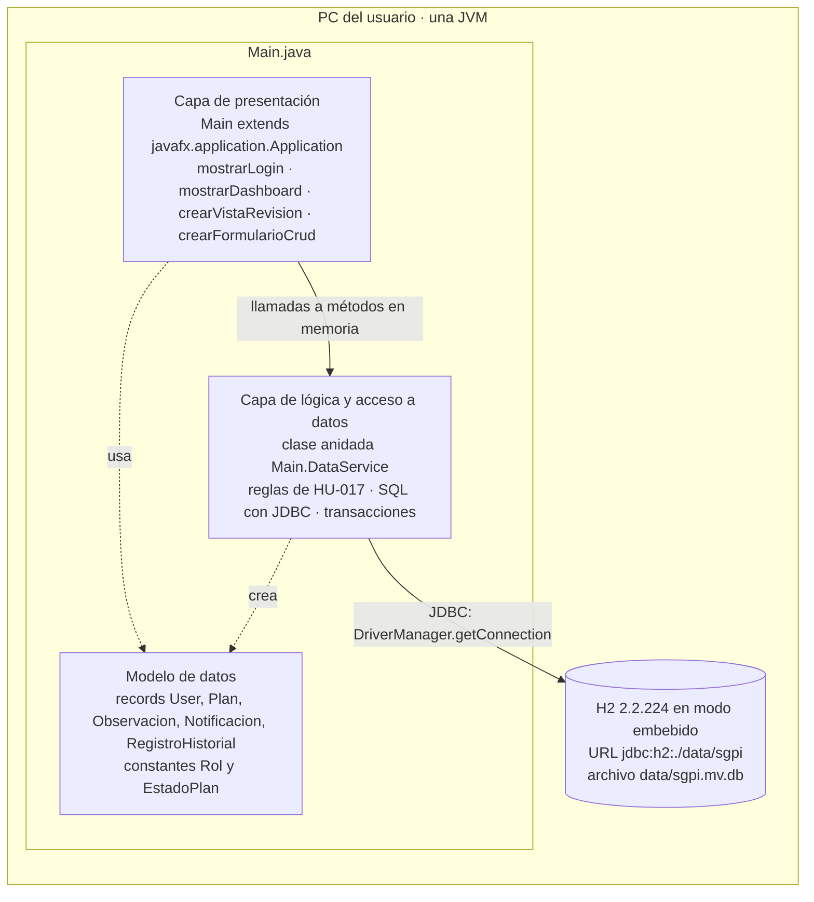
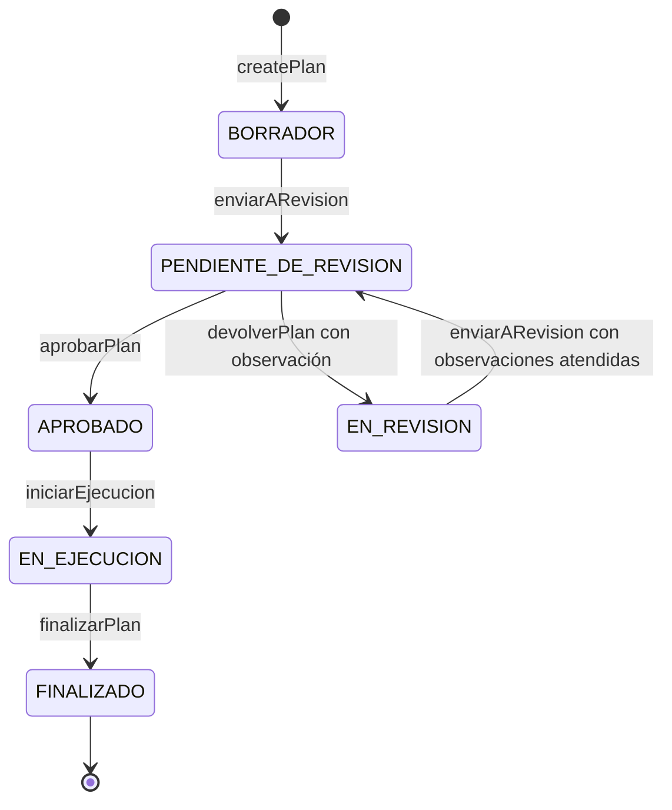
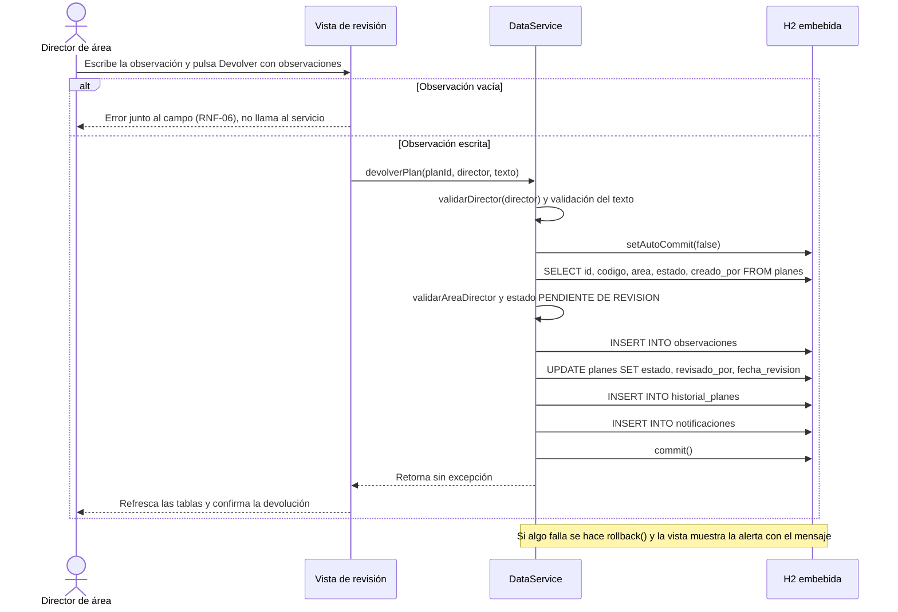
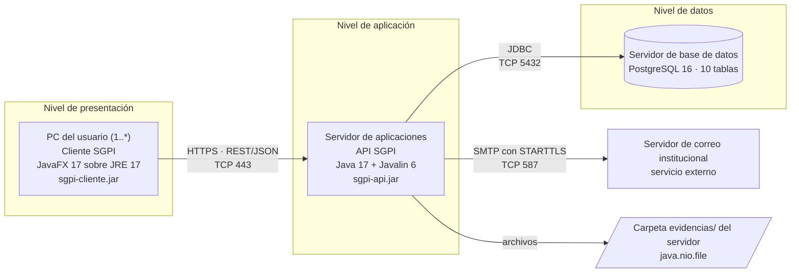
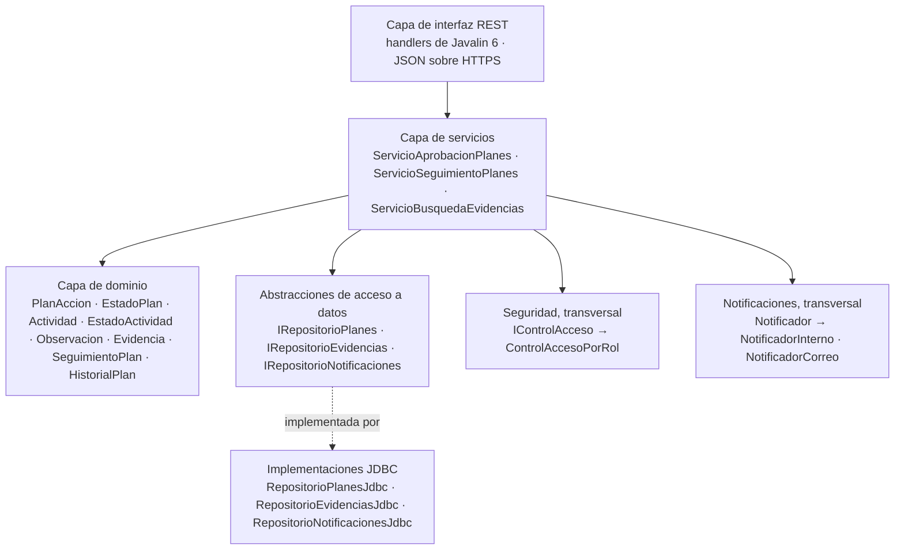
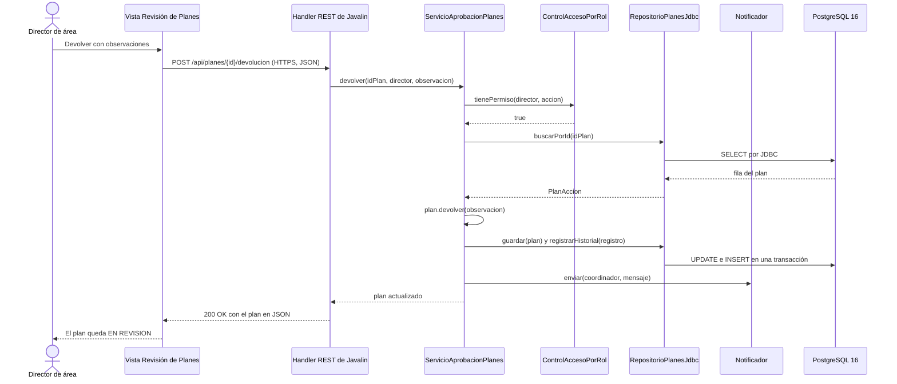
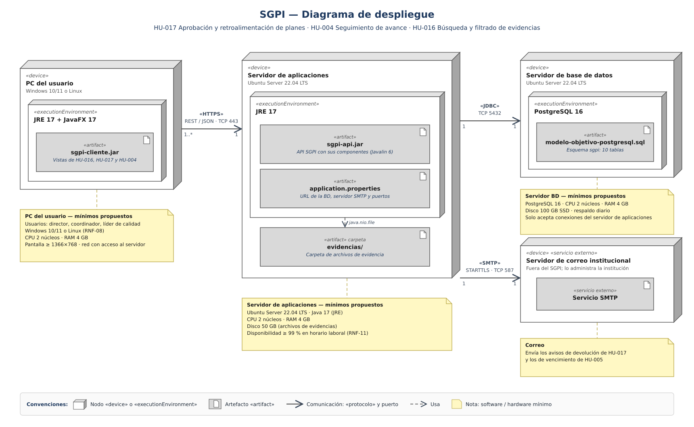

# Modelos arquitectónicos del SGPI

| Campo | Detalle |
|---|---|
| Alcance | Los dos modelos arquitectónicos del proyecto: el **monolítico de escritorio**, que es el prototipo implementado, y el **cliente-servidor de tres niveles**, que es la arquitectura objetivo |
| Fuentes | Código de `main`: [`Main.java`](../../src/main/java/com/sgpi/Main.java), [`AprobacionPlanesTest.java`](../../src/test/java/com/sgpi/AprobacionPlanesTest.java), [`pom.xml`](../../pom.xml) y [`Database`](../../Database). Diagramas de [`Docs/diagramas`](../diagramas) y decisiones de [`arquitectura.md`](arquitectura.md) |
| Fecha | 20 de octubre de 2026 |

## Resumen

| | Modelo 1: monolítico de escritorio | Modelo 2: cliente-servidor de tres niveles |
|---|---|---|
| Estado | Implementado: prototipo de la Entrega 2 (HU-017 completa) | Diseñado: arquitectura objetivo (HU-017, HU-004, HU-016 y HU-020) |
| Unidad de despliegue | Una aplicación JavaFX (`com.sgpi.Main`) | Tres artefactos: `sgpi-cliente.jar`, `sgpi-api.jar` y el esquema de PostgreSQL |
| Niveles físicos | 1: el PC del usuario | 3: PC del usuario, servidor de aplicaciones y servidor de base de datos, más el servidor de correo externo |
| Comunicación interna | Llamadas a métodos dentro de la misma JVM | HTTPS (REST/JSON, puerto 443), JDBC (puerto 5432) y SMTP (puerto 587) |
| Persistencia | H2 2.2.224 embebida, un archivo local por PC | PostgreSQL 16 centralizado, compartido por todos los usuarios |
| Organización del código | Una unidad de compilación de 2.990 líneas con clases anidadas | Componentes con interfaces provistas y requeridas, y capas dentro de la API |

---

## 1. Conceptos

- **Modelo (o estilo) arquitectónico:** la forma de alto nivel en que se reparten las responsabilidades del sistema en elementos, cómo se conectan esos elementos y qué restricciones se cumplen. Decide atributos de calidad como la escalabilidad, la disponibilidad o la mantenibilidad antes de escribir el detalle del código.
- **Capa (*layer*) frente a nivel (*tier*):** una capa es una separación **lógica** de responsabilidades en el código, como presentación, lógica de negocio o acceso a datos. Un nivel es una separación **física**: procesos o máquinas distintas que se comunican por red. Un monolito puede tener varias capas en un solo nivel; la arquitectura de tres niveles reparte esas capas en tres nodos.
- **Monolito:** todo el sistema se compila, se despliega y se ejecuta como una sola unidad, en un solo proceso.
- **Cliente-servidor:** un proceso cliente pide servicios a un proceso servidor por medio de un protocolo de red. En la variante de **tres niveles**, el servidor se divide en servidor de aplicaciones y servidor de base de datos.

---

## 2. Modelo 1: arquitectura monolítica de escritorio (prototipo implementado)

### 2.1 Descripción

El prototipo es una aplicación de escritorio **autónoma** (*standalone*). La interfaz, las reglas de negocio, el acceso a datos y el motor de base de datos corren en **un solo proceso de la JVM** en el PC del usuario. No hay red ni servidor: la base de datos H2 corre en **modo embebido**, es decir, el motor es una librería cargada en la misma JVM que lee y escribe un archivo local.

Toda la aplicación está en un solo archivo fuente, `src/main/java/com/sgpi/Main.java`, de 2.990 líneas. Dentro de ese archivo hay una separación lógica en capas por medio de clases anidadas, pero no hay módulos, paquetes ni interfaces separadas: es un **monolito con capas lógicas**.

### 2.2 Tecnologías y construcción

| Elemento | Valor en `pom.xml` | Función |
|---|---|---|
| Lenguaje | Java 17 (`maven.compiler.release` 17) | Usa *records* (Java 16) y bloques de texto `"""` (Java 15) |
| Interfaz | `org.openjfx:javafx-controls` 17.0.10 | Controles JavaFX; trae `javafx-graphics` y `javafx-base` como dependencias transitivas |
| Base de datos | `com.h2database:h2` 2.2.224 | Motor SQL embebido y driver JDBC en el mismo JAR |
| Seguridad | `org.mindrot:jbcrypt` 0.4 | Hash de contraseñas con BCrypt (RNF-03) |
| Pruebas | `org.junit.jupiter:junit-jupiter` 5.10.1 (`test`) | 12 pruebas de las reglas de HU-017 |
| Compilación | `maven-compiler-plugin` 3.13.0, `maven-surefire-plugin` 3.2.5 | Compila con `--release 17` y ejecuta JUnit 5 |
| Ejecución | `javafx-maven-plugin` 0.0.8, `mainClass` `com.sgpi.Main` | `mvnw javafx:run -Djavafx.platform=win\|linux\|mac` |
| Herramienta | Maven Wrapper con Maven 3.9.16 | No hace falta instalar Maven |

El empaquetado es el de Maven por defecto (`jar`) y no se arma un JAR ejecutable con dependencias: la aplicación se lanza con el plugin de JavaFX, que arma el *module path* con las librerías de la plataforma indicada.

### 2.3 Estructura interna

| Capa lógica | Elementos de `Main.java` | Responsabilidad |
|---|---|---|
| Presentación | `Main` (extiende `Application`): `start(Stage)`, `mostrarLogin()`, `mostrarDashboard(User)`, `crearTablaPlanes()`, `crearFormularioCrud(...)`, `crearVistaRevision(User)`, `mostrarNotificaciones(User)`, `mostrarHistorial(Plan)`, `validarPlan(...)`, `mostrarAlerta(...)` | Construye las pantallas, valida los campos del formulario y muestra los mensajes al usuario |
| Lógica de negocio y acceso a datos | `static class DataService`: `authenticate`, `createPlan`, `updatePlan`, `deletePlan`, `listPlans`, `enviarARevision`, `aprobarPlan`, `devolverPlan`, `marcarObservacionAtendida`, `puedeEjecutarse`, `iniciarEjecucion`, `finalizarPlan`, `listarPendientesRevision`, `listarPlanesArea`, `listarObservaciones`, `listarNotificaciones`, `listarHistorial` | Aplica las reglas de HU-017, controla permisos y ejecuta las sentencias SQL |
| Modelo de datos | `record User`, `Plan`, `Observacion`, `Notificacion`, `RegistroHistorial` y el `record PlanInfo` privado de `DataService`; clases de constantes `Rol` y `EstadoPlan` | Transportan datos inmutables entre las capas |
| Persistencia | H2 embebida, esquema creado por `DataService.init()` | Guarda usuarios, planes, observaciones, notificaciones e historial |

Dependencias entre capas: la vista crea su servicio con `private final DataService database = new DataService();`. Depende de una clase concreta, no de una interfaz, y `DataService` mezcla reglas de negocio con SQL. Por eso las capas existen en el código, pero no están desacopladas.

### 2.4 Mecanismos técnicos

#### Ciclo de vida y navegación (JavaFX)

1. `main(String[])` llama a `Application.launch(args)`.
2. El *runtime* de JavaFX crea el hilo de aplicación (*FX Application Thread*) e invoca `start(Stage)`.
3. `start` inicializa la base con `database.init()`, fija el título de la ventana y muestra `mostrarLogin()`.
4. Cada pantalla se construye en código, sin FXML ni hojas de estilo externas; el estilo se fija con propiedades `-fx-*` en línea. La navegación reemplaza la escena del `Stage` (`stage.setScene(new Scene(root, 1200, 700))`).
5. `mostrarDashboard(User)` decide la vista según el rol: el `DIRECTOR` ve `crearVistaRevision` (pestañas *Pendientes de revisión* y *Planes del área*); `ADMIN` y `COORDINADOR` ven la tabla con el formulario CRUD y los botones del flujo; `RESPONSABLE` entra en modo consulta.
6. Los controles tienen identificador (`setId("btnAprobar")`, `setId("txtObservacion")`). El recorrido automático [`Script/evidencias-prototipo/Evidencias.java`](../../Script/evidencias-prototipo) los localiza con `scene.lookup("#id")`.

Las operaciones de base de datos se ejecutan de forma síncrona en el hilo de JavaFX. Con H2 local la espera es corta; con una base remota habría que moverlas a un `Task` en segundo plano para no congelar la interfaz.

#### Inicialización y evolución del esquema

`DataService.init()`:

1. Crea la carpeta `data/` con `Files.createDirectories` cuando la URL es la de archivo local.
2. Crea las tablas con `CREATE TABLE IF NOT EXISTS`.
3. Ejecuta `crearTablasRevision`, que agrega lo que trajo HU-017 con `ALTER TABLE ... ADD COLUMN IF NOT EXISTS` y `CREATE TABLE IF NOT EXISTS`.
4. Siembra los cuatro usuarios de prueba con `seedUser`, que primero busca el correo y solo inserta si no existe.

Todas las sentencias son **idempotentes**: se pueden ejecutar en cada arranque. Así una base creada con la versión anterior se actualiza sola sin perder datos, sin una herramienta de migraciones como Flyway o Liquibase.

#### Conexiones y transacciones

- Cada operación abre su conexión con `DriverManager.getConnection(url, "sa", "")` dentro de un *try-with-resources*, que la cierra al terminar. No hay *pool* de conexiones.
- En modo embebido, H2 cierra la base cuando se cierra la última conexión, que es el comportamiento por defecto. Por eso cada operación vuelve a abrir el archivo. Es un costo aceptable en un prototipo de un solo usuario.
- Las operaciones del flujo usan el método `enTransaccion(OperacionBD)`, un patrón *execute-around*: desactiva el *auto-commit*, ejecuta la operación recibida como *lambda*, hace `commit()` y, ante una `SQLException` o una `RuntimeException`, hace `rollback()` y relanza la excepción. `OperacionBD` es una `@FunctionalInterface` con el método `ejecutar(Connection)`.
- Gracias a eso, cada caso de uso es **atómico**. Por ejemplo, al devolver un plan se guardan en una sola transacción la observación, el cambio de estado, el registro del historial y la notificación al coordinador; si cualquiera falla, no queda ninguno.
- `createPlan` maneja su propia transacción: inserta el plan con `RETURN_GENERATED_KEYS`, lee el identificador generado y con él arma el código `PA-<año>-<id con 4 dígitos>`, por ejemplo `PA-2026-0007`, antes del `commit()`.

#### Lógica de negocio: *Transaction Script* y máquina de estados

Cada método público de `DataService` implementa un caso de uso completo como un procedimiento: valida el rol, lee el estado actual, verifica las precondiciones, ejecuta el SQL y registra el historial. Es el patrón *Transaction Script*. Las reglas no están en objetos de dominio: los *records* solo transportan datos.

El ciclo de vida del plan es una **máquina de estados** cuyas transiciones solo ocurren por esos métodos:

En la base de datos los estados se guardan con espacios (`PENDIENTE DE REVISION`, `EN REVISION`, `EN EJECUCION`); el diagrama usa guiones bajos porque Mermaid no admite espacios en los nombres de estado.

| Método | Quién puede | Precondiciones | Efectos en la base de datos |
|---|---|---|---|
| `createPlan` | `ADMIN`, `COORDINADOR` | Ninguna, además del rol | `INSERT` en `planes` con estado `BORRADOR`; código `PA-AAAA-NNNN`; historial `CREACION` |
| `updatePlan` | `ADMIN`, `COORDINADOR` | `EstadoPlan.editable(estado)`: `BORRADOR` o `EN REVISION` | `UPDATE` de objetivo, área y fechas |
| `enviarARevision` | `ADMIN`, `COORDINADOR` | Estado editable y ninguna observación sin atender | Estado `PENDIENTE DE REVISION` y `fecha_envio`; historial `ENVIO_REVISION` |
| `aprobarPlan` | `DIRECTOR` del área del plan | Estado `PENDIENTE DE REVISION`; ninguna observación sin atender | Estado `APROBADO`, `revisado_por`, `fecha_revision`; historial `APROBACION`; notificación al creador |
| `devolverPlan` | `DIRECTOR` del área del plan | Observación no vacía y de 1.000 caracteres o menos; estado `PENDIENTE DE REVISION` | `INSERT` en `observaciones`; estado `EN REVISION`; historial `DEVOLUCION`; notificación con el texto |
| `marcarObservacionAtendida` | `ADMIN`, `COORDINADOR` | La observación existe y no está atendida; el plan es editable | `atendida = TRUE` y `fecha_atencion`; historial `OBSERVACION_ATENDIDA` |
| `iniciarEjecucion` | `ADMIN`, `COORDINADOR` | Estado `APROBADO` y ninguna observación sin atender | Estado `EN EJECUCION`; historial `INICIO_EJECUCION` |
| `finalizarPlan` | `ADMIN`, `COORDINADOR` | Estado `EN EJECUCION` | Estado `FINALIZADO`; historial `FINALIZACION` |
| `puedeEjecutarse` | Consulta | — | Devuelve `true` solo si el plan está `APROBADO` y no tiene observaciones pendientes |

`EstadoPlan.DEVUELTO` es un alias de `EN_REVISION`: el estado al que vuelve un plan devuelto se cambia en una sola línea si el equipo adopta el "En borrador" del CU-01.

`finalizarPlan` es una simplificación: el prototipo no tiene actividades, cálculo de avance ni la evaluación de cierre de HU-020.

#### Seguridad

- **Autenticación:** `authenticate(correo, clave)` busca al usuario con `LOWER(correo)=LOWER(?)` y `activo=TRUE`, y compara la clave con `BCrypt.checkpw`. Las claves se guardan con `BCrypt.hashpw(clave, BCrypt.gensalt())`: hash con sal aleatoria y factor de costo 10, el valor por defecto de jBCrypt (RNF-03).
- **Autorización basada en roles:** los roles son cadenas (`ADMIN`, `COORDINADOR`, `RESPONSABLE`, `DIRECTOR`) y se verifican en el servicio con `validarPermiso` (solo `ADMIN` y `COORDINADOR` modifican planes), `validarDirector` y `validarAreaDirector`. Este último compara el área del director con la del plan después de normalizarlas con `trim()` y `toLowerCase(Locale.ROOT)`.
- **Defensa en dos niveles:** la vista valida antes de llamar (por ejemplo, la observación vacía muestra un error junto al campo, RNF-06) y el servicio vuelve a validar todo, así que la regla se cumple aunque se llame sin la interfaz (RNF-05).
- **Inyección SQL:** todas las consultas usan `PreparedStatement` con parámetros. `consultarPlanes(condicion, parametros...)` concatena la condición, pero esas condiciones son literales escritos en el código, nunca texto del usuario.
- **Limitaciones:** la base local no está cifrada y usa el usuario `sa` sin contraseña. Quien tenga acceso al archivo `data/sgpi.mv.db` puede leer o cambiar los datos sin pasar por la aplicación.

#### Manejo de errores

El servicio comunica las violaciones de reglas con excepciones no verificadas: `IllegalArgumentException` para datos inválidos, como una observación vacía o un plan inexistente, e `IllegalStateException` para estados o permisos que no permiten la operación. Las `SQLException` se envuelven en `RuntimeException`. La vista las captura y las muestra con `obtenerMensaje(exception)` y `mostrarAlerta(...)`, con el mensaje en español.

#### Pruebas

- `DataService` tiene dos constructores. El de la aplicación usa `jdbc:h2:./data/sgpi` y el de las pruebas recibe la URL. Ese segundo constructor es el punto de inyección que permite probar las reglas sin interfaz gráfica.
- `AprobacionPlanesTest` crea en cada prueba una base en memoria distinta, `jdbc:h2:mem:sgpi-<UUID>;DB_CLOSE_DELAY=-1`. `DB_CLOSE_DELAY=-1` mantiene viva la base en memoria entre conexiones, porque `DataService` abre y cierra una conexión por operación.
- Son 12 pruebas JUnit 5, entre ellas los casos CP-HU017-01 a CP-HU017-04, y se ejecutan con `mvnw clean test`.
- La interfaz se prueba con el recorrido automático `Evidencias.java`, que corre la aplicación real en una pantalla virtual (Xvfb) y guarda una captura de cada paso.

### 2.5 Modelo de datos del prototipo (H2)

Cinco tablas, documentadas en [`Database/prototipo-h2.sql`](../../Database/prototipo-h2.sql). Las llaves primarias son `BIGINT GENERATED BY DEFAULT AS IDENTITY`.

| Tabla | Columnas principales | Relaciones e integridad |
|---|---|---|
| `usuarios` | `nombre`, `correo` (único), `password_hash`, `rol`, `area`, `activo` | El rol y el área son texto, no tablas |
| `planes` | `codigo` (único), `objetivo`, `area`, `fecha_inicio`, `fecha_fin`, `estado`, `creado_por`, `fecha_envio`, `revisado_por`, `fecha_revision` | `creado_por` → `usuarios.id` |
| `observaciones` | `plan_id`, `autor_id`, `descripcion`, `fecha`, `atendida`, `fecha_atencion` | `plan_id` → `planes.id` con `ON DELETE CASCADE`; `autor_id` → `usuarios.id` |
| `notificaciones` | `usuario_id`, `plan_id`, `mensaje`, `fecha`, `leida` | `usuario_id` → `usuarios.id`; `plan_id` → `planes.id` con `ON DELETE CASCADE` |
| `historial_planes` | `plan_id`, `codigo_plan`, `usuario_id`, `accion`, `estado_anterior`, `estado_nuevo`, `detalle`, `fecha` | **Sin llave foránea a `planes`**: el historial se conserva aunque el plan se elimine (RNF-10, RN-06) |

### 2.6 Secuencia de un caso de uso: devolver un plan

### 2.7 Despliegue

Un solo nodo: el PC del usuario con JDK 17 y las librerías de JavaFX de su plataforma (Windows, Linux o macOS, RNF-08). La base se crea en la carpeta `data/` del directorio desde donde se ejecuta la aplicación.

### 2.8 Evaluación del modelo

| Atributo | Comportamiento en el prototipo | Causa técnica |
|---|---|---|
| Simplicidad | Alta: un artefacto, sin servidores ni configuración de red | Todo corre en una JVM |
| Latencia | Mínima: no hay red | Llamadas en memoria y base embebida |
| Datos compartidos y concurrencia | **No hay**: cada PC tiene su propia base, así que el coordinador y el director solo comparten datos si usan el mismo equipo | En modo embebido el archivo de H2 lo abre un solo proceso a la vez; el prototipo no usa el modo `AUTO_SERVER` |
| Escalabilidad | Solo vertical (un equipo más potente) | No hay componentes distribuibles |
| Disponibilidad (RNF-11) | No aplica: depende del PC de cada usuario | No hay servidor central |
| Mantenibilidad | Baja a medida que crece: un solo archivo de 2.990 líneas | Presentación, reglas y SQL en la misma unidad de compilación; la vista depende de una clase concreta |
| Pruebas | Buenas en las reglas | El constructor con URL permite una base en memoria por prueba |
| Portabilidad de la base (RNF-09) | Parcial | El SQL es estándar en su mayoría, pero `ALTER TABLE ... ADD COLUMN IF NOT EXISTS` no existe en todos los motores (MySQL no lo admite) |
| Auditoría (RNF-10) | Cumple en HU-017 | Cada transición escribe `historial_planes` en la misma transacción |
| Seguridad | Hash de claves correcto; base local sin protección | BCrypt en la aplicación; archivo H2 sin cifrar y usuario `sa` sin contraseña |

---

## 3. Modelo 2: arquitectura cliente-servidor de tres niveles (arquitectura objetivo)

### 3.1 Descripción

La arquitectura objetivo separa el sistema en tres niveles físicos:

1. **Presentación:** un cliente de escritorio JavaFX en el PC de cada usuario. Solo tiene las vistas; no contiene reglas de negocio ni acceso a la base.
2. **Aplicación:** la API SGPI en un servidor de aplicaciones. Concentra las reglas de negocio, la seguridad, las notificaciones y el manejo de archivos, y las publica como servicios REST.
3. **Datos:** PostgreSQL 16 en un servidor de base de datos, al que solo se conecta la API.

El servidor de correo de la institución es un **servicio externo**: no es parte del SGPI, pero la API lo usa para enviar avisos.

Con este modelo todos los usuarios trabajan sobre los mismos datos, las reglas se aplican en un solo lugar y cada nivel se puede administrar, proteger y escalar por separado.

### 3.2 Componentes e interfaces

El diagrama de componentes ([explicación](../diagramas/diagrama-componentes.md)) define qué ofrece y qué necesita cada componente. Una interfaz **provista** es el contrato que el componente implementa; una **requerida** es el contrato del que depende y que implementa otro componente.

| Componente | Nivel | Herramienta | Provee | Requiere |
|---|---|---|---|---|
| Vista Revisión de Planes | Presentación | JavaFX 17 | — | `IAprobacionPlanes` |
| Vista Seguimiento de Planes | Presentación | JavaFX 17 | — | `ISeguimientoPlanes` |
| Vista Búsqueda de Evidencias | Presentación | JavaFX 17 | — | `IBusquedaEvidencias` |
| Gestión de Planes de Acción | Aplicación | Java 17 + Javalin 6 | `IAprobacionPlanes`, `ISeguimientoPlanes` | `IControlAcceso`, `INotificacion`, `IRepositorios` |
| Repositorio Documental | Aplicación | Java 17 + Javalin 6 | `IBusquedaEvidencias` | `IArchivos`, `IEstructuraOrg`, `IControlAcceso`, `IRepositorios` |
| Seguridad y Roles | Aplicación | jBCrypt 0.4 | `IControlAcceso` | `IRepositorios` |
| Notificaciones | Aplicación | Jakarta Mail 2.1 | `INotificacion` | `IRepositorios`, SMTP |
| Estructura Organizacional | Aplicación | Java 17 | `IEstructuraOrg` | `IRepositorios` |
| Gestor de Archivos | Aplicación | `java.nio.file` | `IArchivos` | — |
| Persistencia | Aplicación | JDBC + driver PostgreSQL 42.7 | `IRepositorios` | JDBC |
| BD SGPI | Datos (servicio externo a la API) | PostgreSQL 16 | JDBC, puerto 5432 | — |
| Servidor de correo | Externo | SMTP de la institución | SMTP, puerto 587 | — |

Las interfaces que cruzan del cliente a la API (`IAprobacionPlanes`, `ISeguimientoPlanes`, `IBusquedaEvidencias`) son **remotas**: el cliente no llama a un objeto Java, sino a un recurso HTTP, y Javalin traduce cada petición a la operación del servicio. Las demás son **locales**, dentro del proceso de la API.

### 3.3 Capas internas de la API

La API es un servidor en capas. Cada capa solo depende de la de abajo y de abstracciones (interfaces o clases abstractas), como pide el principio de inversión de dependencias del diagrama de clases.

| Capa | Clases del diagrama de clases | Responsabilidad |
|---|---|---|
| Interfaz REST | Handlers de Javalin (no están en el diagrama de clases) | Recibir la petición HTTP, autenticarla, convertir JSON en parámetros y devolver el código de estado |
| Servicios | `IAprobacionPlanes`, `ISeguimientoPlanes`, `IBusquedaEvidencias` y sus implementaciones | Orquestar cada caso de uso: permisos, reglas, persistencia y avisos |
| Dominio | `PlanAccion`, `EstadoPlan`, `Actividad`, `EstadoActividad`, `Observacion`, `Evidencia`, `SeguimientoPlan`, `HistorialPlan`, `Usuario`, `Rol`, `Area` | Guardar el estado y las reglas propias de cada entidad, como `PlanAccion.puedeEjecutarse()` o `PlanAccion.calcularAvance()` |
| Acceso a datos | `IRepositorio*` y `Repositorio*Jdbc` | Traducir objetos del dominio a filas de PostgreSQL y viceversa |
| Transversales | `IControlAcceso`, `ControlAccesoPorRol`, `Notificador` y sus subclases, `CriterioBusqueda`, `FiltroEvidencia` | Seguridad, avisos y filtros reutilizables |

A diferencia del prototipo, las reglas pasan de procedimientos a un **modelo de dominio**: `PlanAccion` decide si puede aprobarse, devolverse o ejecutarse, y el servicio coordina. Las extensiones se hacen agregando clases, no modificando las existentes: un filtro nuevo de evidencias implementa `FiltroEvidencia` y un canal de aviso nuevo hereda de `Notificador`.

### 3.4 Protocolos y conectores

| Conector | De → hacia | Protocolo y puerto | Multiplicidad | Detalle técnico |
|---|---|---|---|---|
| Cliente → API | PC del usuario → servidor de aplicaciones | HTTPS, TCP 443 | 1..* a 1 | HTTP sobre TLS; cuerpos en JSON; cada petición lleva la identidad del usuario para que la API aplique sus permisos |
| API → base de datos | Servidor de aplicaciones → servidor de BD | JDBC, TCP 5432 | 1 a 1 | Driver PostgreSQL 42.7 (tipo 4, Java puro), que habla el protocolo de PostgreSQL sobre TCP |
| API → correo | Servidor de aplicaciones → servidor de correo | SMTP con STARTTLS, TCP 587 | 1 a 1 | Puerto de envío de mensajes; la conexión empieza en claro y se cifra con STARTTLS |
| API → archivos | Proceso de la API → carpeta `evidencias/` | Llamadas al sistema de archivos | Local | `java.nio.file` guarda y lee los archivos de evidencia |

### 3.5 Contrato REST propuesto

El diseño define las operaciones de cada interfaz, pero todavía no las rutas HTTP. Esta es una **propuesta** de cómo publicarlas con Javalin, para discutirla con el equipo:

| Operación de la interfaz | Método y ruta propuestos | Respuesta correcta |
|---|---|---|
| `IAprobacionPlanes.listarPendientes(director)` | `GET /api/planes?estado=PENDIENTE_REVISION` | `200` con la lista de planes del área del director |
| `IAprobacionPlanes.aprobar(idPlan, director)` | `POST /api/planes/{id}/aprobacion` | `200` con el plan en `APROBADO` |
| `IAprobacionPlanes.devolver(idPlan, director, observacion)` | `POST /api/planes/{id}/devolucion` con `{"observacion": "..."}` | `200` con el plan en `EN REVISION` |
| `ISeguimientoPlanes.calcularAvance(idPlan)` | `GET /api/planes/{id}/avance` | `200` con `{"avance": 75}` |
| `ISeguimientoPlanes.cambiarEstado(idActividad, nuevo, usuario)` | `PATCH /api/actividades/{id}/estado` | `200` con la actividad |
| `ISeguimientoPlanes.registrarSeguimiento(idPlan, comentario, usuario)` | `POST /api/planes/{id}/seguimientos` | `201` con el seguimiento creado |
| `IBusquedaEvidencias.buscar(palabraClave, usuario)` | `GET /api/evidencias?q=...` | `200` con las evidencias que el usuario puede ver |
| `IBusquedaEvidencias.filtrar(criterio, usuario)` | `GET /api/evidencias?tipo=&desde=&hasta=&area=&responsable=` | `200` con las evidencias filtradas |

Las excepciones que hoy usa el prototipo se traducirían en códigos de estado HTTP:

| Situación | En el prototipo | En la API |
|---|---|---|
| Dato inválido, como una observación vacía | `IllegalArgumentException` | `400 Bad Request` |
| Sin sesión o sesión vencida | No aplica | `401 Unauthorized` |
| Rol o área sin permiso | `IllegalStateException` de `validarDirector` o `validarAreaDirector` | `403 Forbidden` |
| El plan no existe | `IllegalArgumentException("El plan no existe.")` | `404 Not Found` |
| La operación no es válida en el estado actual | `IllegalStateException`, por ejemplo aprobar un plan en `BORRADOR` | `409 Conflict` |
| Falla de la base de datos | `RuntimeException` que envuelve una `SQLException` | `500 Internal Server Error` |

### 3.6 Modelo de datos objetivo (PostgreSQL 16)

El script está en [`Database/modelo-objetivo-postgresql.sql`](../../Database/modelo-objetivo-postgresql.sql) y cubre HU-016, HU-017, HU-004 y HU-020.

- Diez tablas: `area`, `rol`, `usuario`, `plan_accion`, `actividad`, `evidencia`, `observacion`, `notificacion`, `seguimiento_plan` e `historial_plan`. Las llaves primarias son `SERIAL`.
- A diferencia del prototipo, el rol y el área son tablas referenciadas con llaves foráneas desde `usuario`, y `plan_accion` referencia dos veces a `usuario`: `id_coordinador` e `id_director`.
- **Integridad declarativa con `CHECK`:**
  - los estados válidos del plan y de la actividad;
  - `fecha_fin >= fecha_inicio`;
  - `avance_calculado BETWEEN 0 AND 100`;
  - un plan está `FINALIZADO` si y solo si tiene calificación y fecha de cierre (HU-020).

  En el prototipo estas reglas solo las aplica el código Java.
- **Eliminación en cascada:** actividades, evidencias, observaciones, notificaciones y seguimientos se borran con su plan (`ON DELETE CASCADE`). `historial_plan` no tiene llave foránea al plan, para conservar la auditoría (RNF-10).
- **Vista `avance_plan`:** calcula el avance de HU-004 en la base con `COUNT(...) FILTER (WHERE estado = 'FINALIZADA') * 100 / NULLIF(COUNT(...), 0)`, envuelto en `COALESCE(..., 0)` para que un plan sin actividades tenga avance 0. El avance no se guarda, así que no se desincroniza.

### 3.7 Secuencia de un caso de uso: devolver un plan

El diagrama de secuencia completo de HU-017 con los componentes de esta arquitectura está en [`Graficas/diagrama-secuencia-hu017.png`](../../Graficas/diagrama-secuencia-hu017.png) y se explica en [`arquitectura.md`](arquitectura.md#6-diagrama-de-secuencia-hu-017).

### 3.8 Despliegue

| Nodo «device» | Entorno de ejecución | Artefactos | Mínimos propuestos |
|---|---|---|---|
| PC del usuario | JRE 17 + JavaFX 17 | `sgpi-cliente.jar` | Windows 10/11 o Linux (RNF-08), 2 núcleos, 4 GB de RAM, pantalla de 1366×768 o más |
| Servidor de aplicaciones | JRE 17 sobre Ubuntu Server 22.04 LTS | `sgpi-api.jar`, `application.properties`, carpeta `evidencias/` | 2 núcleos, 4 GB de RAM, disco de 50 GB, disponibilidad de 99 % en horario laboral (RNF-11) |
| Servidor de base de datos | PostgreSQL 16 sobre Ubuntu Server 22.04 LTS | `modelo-objetivo-postgresql.sql` | 2 núcleos, 4 GB de RAM, disco SSD de 100 GB, respaldo diario |
| Servidor de correo institucional | Lo administra la institución | Servicio SMTP | — |

`application.properties` guarda la URL de la base, el servidor SMTP y los puertos, para cambiar de entorno sin recompilar. La base de datos solo acepta conexiones del servidor de aplicaciones.

### 3.9 Seguridad

- **Canal cifrado:** el cliente habla con la API solo por HTTPS (TLS) y la API envía correo con STARTTLS.
- **Control de acceso centralizado:** `ControlAccesoPorRol` implementa `IControlAcceso.tienePermiso(usuario, accion)` y todos los servicios lo consultan antes de actuar. Lo que no está permitido explícitamente se niega (RNF-05).
- **Contraseñas:** el hash BCrypt se calcula y se verifica en el servidor (RNF-03); el cliente nunca accede a la tabla de usuarios.
- **Superficie de ataque reducida:** el cliente no tiene credenciales de la base y la base no está expuesta a la red de usuarios, solo al servidor de aplicaciones.

### 3.10 Evaluación del modelo

| Atributo | Comportamiento esperado | Causa técnica |
|---|---|---|
| Datos compartidos y concurrencia | Todos los usuarios ven los mismos planes; el coordinador y el director trabajan desde equipos distintos | Una sola base PostgreSQL con control de concurrencia multiversión (MVCC) y transacciones en la API |
| Escalabilidad | Horizontal en la API y vertical en la base | La API puede replicarse detrás de un balanceador si no guarda estado de sesión en memoria |
| Mantenibilidad | Alta | Componentes con interfaces, capas y principios SOLID; cada parte se cambia sin tocar las demás |
| Portabilidad de la base (RNF-09) | Alta | Los servicios dependen de `IRepositorio*`; para pasar a MySQL se cambian las implementaciones JDBC, no la lógica |
| Disponibilidad (RNF-11) | Depende del servidor de aplicaciones y del de base de datos | Cada uno es un punto único de falla en el diseño actual; el 99 % exige monitoreo, reinicio automático y respaldos |
| Latencia | Mayor que en el prototipo | Cada operación cruza la red (HTTPS) y otra vez (JDBC) |
| Complejidad operativa | Mayor | Tres nodos que instalar, asegurar, monitorear y respaldar |
| Auditoría (RNF-10) | Cumple | `historial_plan` sin llave foránea, escrito en la misma transacción que el cambio |

### 3.11 Aspectos técnicos por definir

El diseño deja abiertas estas decisiones. Las propuestas son recomendaciones, no parte de los diagramas:

| Tema | Pendiente | Propuesta |
|---|---|---|
| Sesión en la API | Cómo se identifica el usuario en cada petición | Un *token* firmado que la API entrega al iniciar sesión y el cliente envía en la cabecera `Authorization`, para que la API no guarde estado de sesión |
| Conexiones a la base | La API atiende a varios usuarios a la vez | Un *pool* de conexiones JDBC en lugar de abrir una conexión por operación como el prototipo |
| Serialización | Formato exacto del JSON | El mapeador JSON que integra Javalin, con los *records* como objetos de transferencia |
| Cliente HTTP | Cómo llama el cliente JavaFX a la API | `java.net.http.HttpClient` del JDK 17, en tareas de segundo plano para no bloquear la interfaz |
| Migraciones | Cómo evoluciona el esquema de PostgreSQL | Scripts versionados con una herramienta de migraciones, en lugar de los `IF NOT EXISTS` del prototipo |
| Empaquetado del cliente | Cómo se instala `sgpi-cliente.jar` con JavaFX | Un instalador por sistema operativo generado con `jpackage` |

---

## 4. Comparación de los dos modelos

| Dimensión | Monolítico de escritorio | Cliente-servidor de tres niveles |
|---|---|---|
| Procesos | 1 JVM | Cliente JVM por usuario, API JVM y proceso de PostgreSQL |
| Distribución de capas | Presentación, lógica y datos en el mismo nivel | Presentación en el cliente; lógica en la API; datos en el servidor de BD |
| Llamadas entre capas | Métodos Java en memoria | HTTP con JSON entre cliente y API; métodos Java dentro de la API |
| Lógica de negocio | *Transaction Script* en `DataService` | Modelo de dominio (`PlanAccion` y demás) coordinado por servicios |
| Desacoplamiento | Clase concreta (`new DataService()`) | Interfaces provistas y requeridas; inversión de dependencias |
| Base de datos | H2 2.2.224 embebida, un archivo por PC | PostgreSQL 16 central |
| Integridad | En el código Java | En el código y en la base (`CHECK`, llaves foráneas, vista de avance) |
| Esquema | 5 tablas, creadas al arrancar | 10 tablas y una vista, con script versionado |
| Concurrencia | Un proceso por base | Muchos clientes sobre una base con MVCC |
| Seguridad | Hash BCrypt; base local sin cifrar | Hash BCrypt en el servidor; TLS; base no expuesta |
| Despliegue | Copiar y ejecutar en cada PC | Tres nodos con su configuración |
| Historias cubiertas | HU-017 completa | HU-017, HU-004, HU-016 y HU-020 |
| Uso en el proyecto | Validar el flujo de HU-017 con usuarios y pruebas | Base para construir el sistema completo |

---

## 5. Del prototipo a la arquitectura objetivo

### 5.1 Correspondencia de elementos

Cada pieza del prototipo tiene su lugar en el modelo objetivo:

| Elemento del prototipo (`Main.java`) | Elemento del modelo objetivo |
|---|---|
| `crearVistaRevision(User)` | Vista Revisión de Planes del cliente |
| `DataService.aprobarPlan`, `devolverPlan`, `listarPendientesRevision` | `ServicioAprobacionPlanes` (`IAprobacionPlanes`) |
| `DataService.puedeEjecutarse`, `iniciarEjecucion` | `PlanAccion.puedeEjecutarse()` y el servicio de seguimiento |
| `validarPermiso`, `validarDirector`, `validarAreaDirector` | `ControlAccesoPorRol` (`IControlAcceso`) |
| `notificar(...)` y la tabla `notificaciones` | `NotificadorInterno`; `NotificadorCorreo` agrega el canal de correo |
| `registrarHistorial(...)` y la tabla `historial_planes` | `IRepositorioPlanes.registrarHistorial` y la tabla `historial_plan` |
| SQL de `leerPlan`, `consultarPlanes`, `actualizarEstado` | `RepositorioPlanesJdbc` |
| `enTransaccion(OperacionBD)` | Manejo de transacciones de la capa de servicios |
| `EstadoPlan` (constantes de texto) | Clase `EstadoPlan` con el atributo `estado` |
| `authenticate` con BCrypt | Seguridad y Roles, en el servidor |
| H2 embebida (`jdbc:h2:./data/sgpi`) | PostgreSQL 16 (`modelo-objetivo-postgresql.sql`) |

### 5.2 Pasos sugeridos

Esta es una propuesta para migrar sin perder lo que ya funciona:

1. **Refactorizar dentro del monolito:** extraer de `DataService` las interfaces `IAprobacionPlanes`, `IControlAcceso` e `IRepositorioPlanes`, y que la vista dependa de ellas. Las 12 pruebas de `AprobacionPlanesTest` sirven de red de seguridad: deben seguir pasando sin cambios en el comportamiento.
2. **Separar el acceso a datos:** mover el SQL a repositorios JDBC y las reglas de estado a `PlanAccion`.
3. **Cambiar de motor:** apuntar los repositorios a PostgreSQL 16 con el modelo objetivo y probar con una base de pruebas.
4. **Publicar la API:** exponer los servicios con Javalin sobre HTTPS, con el contrato REST acordado.
5. **Convertir el cliente:** reemplazar las llamadas a `DataService` por llamadas HTTP a la API.
6. **Desplegar:** instalar los tres nodos con los mínimos del diagrama de despliegue y abrir solo los puertos 443, 5432 y 587 entre los nodos que los usan.

---

## 6. Referencias del repositorio

| Documento o archivo | Contenido |
|---|---|
| [`arquitectura.md`](arquitectura.md) | Arquitectura objetivo, diferencias con el prototipo y decisiones del 18 de octubre |
| [`Docs/diagramas`](../diagramas) | Diagramas de análisis (ECB), clases, componentes y despliegue del Taller de Diseño |
| [`src/main/java/com/sgpi/Main.java`](../../src/main/java/com/sgpi/Main.java) | Código del prototipo |
| [`src/test/java/com/sgpi/AprobacionPlanesTest.java`](../../src/test/java/com/sgpi/AprobacionPlanesTest.java) | Pruebas de HU-017 |
| [`Database/prototipo-h2.sql`](../../Database/prototipo-h2.sql) | Esquema H2 del prototipo |
| [`Database/modelo-objetivo-postgresql.sql`](../../Database/modelo-objetivo-postgresql.sql) | Esquema PostgreSQL de la arquitectura objetivo |
| [`README-PROTOTIPO.md`](../../README-PROTOTIPO.md) | Cómo compilar, ejecutar y probar el prototipo |
