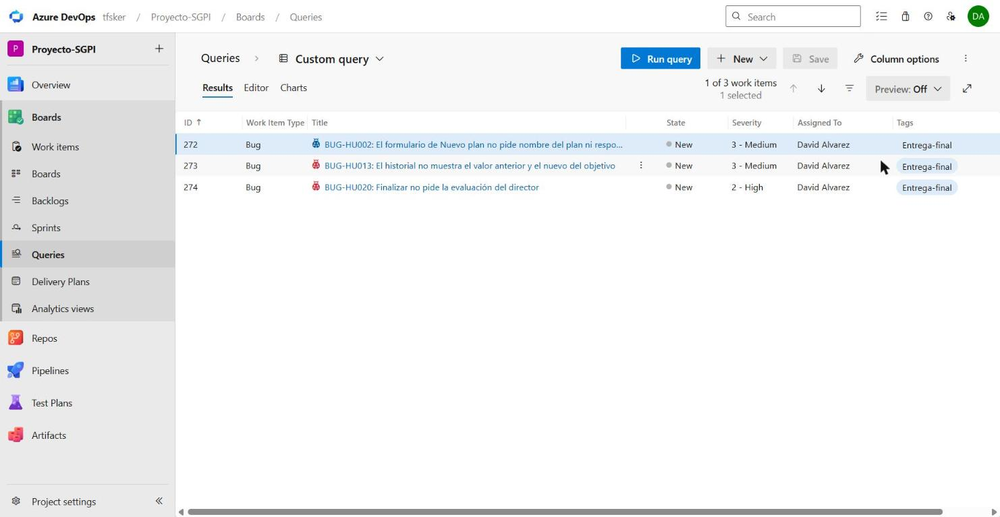

# Reporte de pruebas — Entrega final

| Campo | Detalle |
|---|---|
| Proyecto | SGPI: Sistema de Gestión de Procesos Institucionales (Grupo Los FIS) |
| Fecha de ejecución | 19 de noviembre de 2026 |
| Versión probada | Rama `main` en `d61e931` (PR #90) |
| Ejecutado por | David Álvarez Rodríguez (Gestión y Reportes) |
| Herramientas | Azure DevOps Test Plans (plan #158, proyecto Proyecto-SGPI) y Maven con JUnit 5 |
| Entorno | Windows 11, aplicación abierta con `.\mvnw.cmd javafx:run "-Djavafx.platform=win"`, base H2 local nueva |

## 1. Resumen

| Tipo de prueba | Diseñadas | Ejecutadas | Pasaron | Fallaron | Bloqueadas | Bugs |
|---|---|---|---|---|---|---|
| Casos manuales en Azure DevOps | 12 | 12 | 9 | 3 | 0 | 3 |
| Pruebas automáticas JUnit | 76 | 76 | 76 | 0 | 0 | — |

Aprobación de los casos manuales: 9 de 12 (75 %). Cada paso de cada caso quedó en Azure DevOps con su resultado, un comentario de lo observado y la captura de la aplicación (Test Runs 1000030 a 1000041).

## 2. Resultado por caso

| Caso | Suite (HU) | Pasos | Resultado | Bug | Observación |
|---|---|---|---|---|---|
| CP-001 | HU-017 Aprobación | 3 | Passed | — | El director de Calidad solo ve los planes de su área. |
| CP-002 | HU-017 Aprobación | 3 | Passed | — | Solo el director ve la revisión y los botones Aprobar y Devolver. |
| CP-003 | HU-017 Aprobación | 4 | Passed | — | Devolver exige observaciones; el plan queda EN REVISION y el coordinador recibe la notificación. |
| CP-004 | HU-017 Aprobación | 4 | Passed | — | El plan devuelto se edita, el historial registra la modificación y vuelve a PENDIENTE DE REVISION. |
| CP-011 | HU-002 Registro de planes | 1 | Failed | #272 | El formulario pide objetivo, área y fechas, pero no el nombre del plan ni el responsable que pide el issue #19. |
| CP-010 | HU-013 Historial | 2 | Failed | #273 | El historial registra "MODIFICACION" pero no el objetivo anterior ni el nuevo. |
| CP-006 | HU-005 Vencimientos | 4 | Passed | — | El responsable recibe el aviso de una actividad que vence en 5 días. |
| CP-008 | HU-003 Evidencias | 1 | Passed | — | Una actividad sin evidencia no se puede marcar FINALIZADA. |
| CP-007 | HU-005 Vencimientos | 3 | Passed | — | Una actividad finalizada no genera avisos nuevos. |
| CP-009 | HU-020 Cierre del plan | 2 | Failed | #274 | **Finalizar** cierra el plan sin pedir la evaluación del director. |
| CP-005 | HU-001 Login | 3 | Passed | — | Tres intentos de inyección SQL se rechazan sin errores de base de datos. |
| CP-012 | HU-001 Login | 2 | Passed | — | Al tercer intento fallido la cuenta se bloquea 15 minutos. |

## 3. Defectos registrados en Azure DevOps

| Id | Título | Severidad | Caso | Estado |
|---|---|---|---|---|
| 272 | BUG-HU002: El formulario de Nuevo plan no pide nombre del plan ni responsable | 3 - Medium | CP-011 | New |
| 273 | BUG-HU013: El historial no muestra el valor anterior y el nuevo del objetivo | 3 - Medium | CP-010 | New |
| 274 | BUG-HU020: Finalizar no pide la evaluación del director | 2 - High | CP-009 | New |

Los tres están asignados a David Álvarez, con la etiqueta `Entrega-final`, la captura de la falla y el enlace al caso (Tested By). Los tres corresponden a funciones que el [README](../../README.md#-estado-actual-del-prototipo) ya marcaba como incompletas (HU-002 en parte, HU-020 sin programar); quedan en el backlog para después de la entrega.

## 4. Observaciones de la ejecución

- **CP-007:** la revisión periódica de vencimientos (cada 5 minutos) generó un aviso a las 15:24, entre la aprobación del plan y la finalización de la actividad. Es el comportamiento esperado; después de finalizar no apareció ningún aviso nuevo.
- **CP-006:** en el primer intento la fecha límite escrita no se confirmó al pasar con Tab y quedó otra fecha. Se volvió a crear la actividad confirmando con Enter. Es una mejora de usabilidad del selector de fecha, no un defecto del aviso.
- **CP-005:** se usaron correos que no corresponden a cuentas reales para no bloquear ninguna cuenta.
- **17 puntos de prueba en el *Progress report*:** al crear el plan, los casos CP-001 a CP-005 quedaron también, por error, en la suite raíz, además de en sus suites de HU. Esas 5 copias nunca se ejecutaron y se quitaron de la suite raíz después de la ejecución; aun así, el *Progress report* de Azure conserva el histórico y muestra 17 puntos (12 ejecutados y 5 sin ejecutar). Los casos reales son 12 y los 12 se ejecutaron.

## 5. Evidencias

- En Azure DevOps: plan #158, una captura por paso adjunta a cada resultado (Test Runs 1000030 a 1000041), *Progress report* y gráfico por resultado.
- En el repositorio, carpeta [`evidencias/azure`](evidencias/azure): lista de bugs, cada bug y las capturas de los pasos que fallaron.
- Pruebas automáticas: [`evidencias/resultado-maven-entrega-final.txt`](evidencias/resultado-maven-entrega-final.txt).

