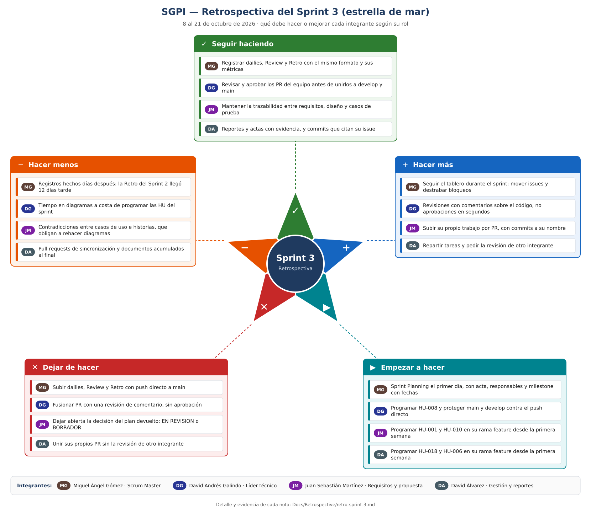

# Retrospectiva - Sprint 3

> Cada integrante tiene una nota por brazo de la estrella de mar, según su rol. Las notas salen de lo que muestra el repositorio durante el sprint (issues, pull requests, commits, dailies y actas), y el equipo las revisó y aprobó el 22 de octubre de 2026.

**Fecha:** 22/10/2026
**Scrum Master:** Miguel Ángel Gómez López
**Asistentes:** David Galindo, Miguel Gómez, Juan Martínez, David Álvarez
**Sprint:** 8 al 21 de octubre de 2026
**Técnica:** estrella de mar (*Starfish*)

La estrella de mar divide la conversación en cinco brazos:

- **Seguir haciendo:** lo que funcionó y se mantiene.
- **Hacer más** y **hacer menos:** ajustan prácticas que ya existen.
- **Empezar a hacer** y **dejar de hacer:** agregan o eliminan prácticas.

| Sigla | Integrante | Rol |
|---|---|---|
| MG | Miguel Ángel Gómez López | Scrum Master / Planeación ágil |
| DG | David Andrés Galindo Rojas | Líder técnico / Repositorio y arquitectura |
| JM | Juan Sebastián Martínez | Requisitos y propuesta |
| DA | David Álvarez Rodríguez | Gestión y reportes |

## Lo que pasó en el sprint

| Dato | Valor | Fuente |
|---|---|---|
| Objetivo del sprint | Acceso, roles y registro de planes: HU-001, HU-006, HU-018, HU-008, HU-010 y HU-002 | [Acta de planning del Sprint 3](../Planning/Acta-Planning-Sprint3.md) |
| HU del objetivo con código nuevo | 0 de 6; sus issues siguen abiertos y ninguna tiene rama ni PR | Issues #1, #6, #26, #8, #10 y #19 |
| HU-017 | Unida a `main` el 12 de octubre con 12 pruebas JUnit (PR #40); el issue #25 sigue abierto | PR #40 |
| Pull requests fusionados | 24, del #40 al #73; 21 de ellos entre el 16 y el 20 de octubre | Pestaña *Pull requests* |
| Pull requests solo para sincronizar ramas | 5: #47, #51, #53, #55 y #61 | Pestaña *Pull requests* |
| Commits en `main`, sin contar fusiones | 87: 75 de David Álvarez y 12 de Miguel Ángel Gómez | `git log` del 8 al 21 de octubre |
| Commits directos a `main`, sin PR | 12: dailies 7 a 14, Review y Retrospectiva del Sprint 2 | `git log --first-parent` |
| Dailies registradas | Hasta el día 14 (9 de octubre); se subieron el 19 y el 20 de octubre | [`Docs/Dailys`](../Dailys) |
| Entregas de diseño | Taller de Diseño (issues #66 a #69), diagramas en [`Docs/diagramas`](../diagramas) y [modelos arquitectónicos](../Arquitectura/modelos-arquitectonicos.md) | PR #70 a #73 |

## Notas por integrante

### MG · Miguel Ángel Gómez (Scrum Master)

| Brazo | Nota | Evidencia |
|---|---|---|
| Seguir haciendo | Registrar dailies, Review y Retro con el mismo formato y sus métricas | Dailies de los días 1 a 14 con el mismo formato; Review y Retrospectiva del Sprint 2 en `Docs/Review` y `Docs/Retrospective` |
| Hacer más | Seguir el tablero durante el sprint: mover issues y destrabar bloqueos | Las HU del objetivo no están en el milestone "Sprint 3" y la HU-002 (#19) no tiene responsable |
| Empezar a hacer | Sprint Planning el primer día, con acta, responsables y milestone con fechas | El acta del Sprint 3 es un borrador del 18 de octubre con la fecha, los asistentes, las estimaciones y los acuerdos sin completar; los issues usaban un solo milestone, "Sprint", vencido desde septiembre |
| Dejar de hacer | Subir dailies, Review y Retro con push directo a `main` | 12 commits directos a `main` el 19 y el 20 de octubre, aunque el README dice que `main` solo recibe `develop` |
| Hacer menos | Registros hechos días después | La Review y la Retrospectiva del Sprint 2 se registraron el 19 de octubre, doce días después de cerrar ese sprint; no hay dailies después del 9 de octubre |

### DG · David Andrés Galindo (Líder técnico)

| Brazo | Nota | Evidencia |
|---|---|---|
| Seguir haciendo | Revisar y aprobar los PR del equipo antes de unirlos a `develop` y `main` | Aprobó los PR #63, #65, #70, #71 y #73 |
| Hacer más | Revisiones con comentarios sobre el código, no aprobaciones en segundos | Los PR #63 y #65 se aprobaron menos de un minuto después de abrirse, sin comentarios |
| Empezar a hacer | Programar HU-008 y proteger `main` y `develop` contra el push directo | HU-008 (#8) está a su cargo y no tiene rama ni PR; los 12 commits directos a `main` muestran que la rama no está protegida |
| Dejar de hacer | Fusionar PR con una revisión de comentario, sin aprobación | El PR #72 se fusionó con una revisión de tipo comentario ("submit") |
| Hacer menos | Tiempo en diagramas a costa de programar las HU del sprint | Sus dailies del 5 al 9 de octubre son casi todas de diagramas; ninguna HU del objetivo tiene código |

### JM · Juan Sebastián Martínez (Requisitos y propuesta)

| Brazo | Nota | Evidencia |
|---|---|---|
| Seguir haciendo | Mantener la trazabilidad entre requisitos, diseño y casos de prueba | Dailies 9 y 10: trazó los requisitos frente al diseño y revisó los casos de prueba de HU-016 y HU-017 |
| Hacer más | Subir su propio trabajo por PR, con commits a su nombre | Sus últimos commits en el repositorio son del 6 de octubre (PR #36) |
| Empezar a hacer | Programar HU-001 y HU-010 en su rama `feature/` desde la primera semana | Los issues #1 y #10 están a su cargo y no tienen rama ni PR |
| Dejar de hacer | Dejar abierta la decisión del plan devuelto: EN REVISION o BORRADOR | Sigue pendiente en [`arquitectura.md`](../Arquitectura/arquitectura.md) y en el acta de planning; el código usa EN REVISION por ahora |
| Hacer menos | Contradicciones entre casos de uso e historias, que obligan a rehacer diagramas | El CU-01 dice que un plan devuelto vuelve a "En borrador" y la HU-017 dice "En revisión"; el diseño de HU-004 tuvo que alinearse con el requisito en el PR #54 |

### DA · David Álvarez (Gestión y reportes)

| Brazo | Nota | Evidencia |
|---|---|---|
| Seguir haciendo | Reportes y actas con evidencia, y commits que citan su issue | Reporte gerencial y acta de pruebas del Sprint 2 (PR #43); commits del taller que citan los issues #66 a #69 |
| Hacer más | Repartir tareas y pedir la revisión de otro integrante | 75 de los 87 commits del sprint en `main` son suyos |
| Empezar a hacer | Programar HU-018 y HU-006 en su rama `feature/` desde la primera semana | Los issues #26 y #6 están a su cargo y no tienen rama ni PR |
| Dejar de hacer | Unir sus propios PR sin la revisión de otro integrante | El PR #53 se unió 14 segundos después de abrirse, sin revisión |
| Hacer menos | Pull requests de sincronización y documentos acumulados al final | 5 PR solo sincronizaron `develop` y `main`; 21 de los 24 PR del sprint se fusionaron entre el 16 y el 20 de octubre |

## Seguimiento de la retrospectiva del Sprint 2

| Acción del Sprint 2 | Responsable | Estado | Evidencia |
|---|---|---|---|
| Alinear el código con la documentación de arquitectura | Líder técnico | Cumplida | `arquitectura.md` distingue la arquitectura objetivo del prototipo; diagramas corregidos en los PR #52, #54 y #64 |
| Mover las HU en el tablero solo cuando haya código o pruebas | Scrum Master | Parcial | El 18 de octubre se reabrieron los issues cerrados sin implementar; las HU del Sprint 3 siguen sin avance |
| Revisión cruzada de requisitos antes de programar | Requisitos | Parcial | Las decisiones del 18 de octubre alinearon HU-004 y HU-020; sigue pendiente el estado de un plan devuelto (HU-017 frente a CU-01) |

## Plan de acción para el Sprint 4

| Integrante | Acción | Cómo se verifica |
|---|---|---|
| MG | Hacer la Sprint Planning el primer día y registrar el acta completa | Acta en `Docs/Planning` con objetivo, HU estimadas y responsables, sin campos por completar |
| MG | Crear el milestone "Sprint 4" con fechas y asignarle todas las HU | Milestone con fecha de cierre y los issues del sprint |
| MG | Registrar cada daily el mismo día, por PR a `develop` | Un archivo por día hábil, con fecha igual a la del commit |
| DG | Proteger `main` y `develop`: sin push directo y con al menos una aprobación por PR | Reglas de protección activas en GitHub |
| DG | Revisar cada PR con al menos un comentario sobre el cambio antes de aprobarlo | Revisiones con comentarios en los PR del sprint |
| DG | Abrir la rama de HU-008 en la primera semana | Rama `feature/HU-008-...` y PR en borrador |
| JM | Decidir el estado de un plan devuelto antes de la planning y unificar HU-017 y CU-01 | Decisión registrada en `arquitectura.md` y en la propuesta |
| JM | Abrir las ramas de HU-001 y HU-010 en la primera semana y subir su trabajo por PR | Ramas, PR y commits a su nombre |
| DA | Abrir las ramas de HU-018 y HU-006 en la primera semana | Ramas `feature/` y PR en borrador |
| DA | No unir PR propios sin la aprobación de otro integrante | Todos sus PR con una revisión aprobada |
| DA | Repartir los reportes del sprint con fechas en el planning | Responsables y fechas en el acta de planning |
