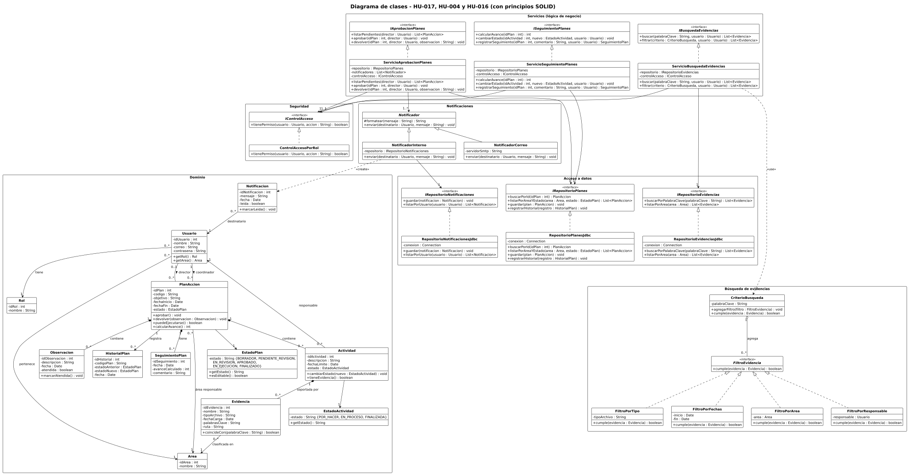

# Diagrama de clases

| Campo | Detalle |
|---|---|
| Historias de usuario | HU-017 (principal), HU-004 y HU-016 |
| Issue | #67 (sub-issue de HU-017, #25) |
| Fuente editable | [`diagrama-clases.puml`](diagrama-clases.puml) (PlantUML); la imagen [`diagrama-clases.svg`](diagrama-clases.svg) se genera con `java -jar plantuml.jar -tsvg diagrama-clases.puml` |

## Organización

Las clases están agrupadas en seis paquetes:

| Paquete | Clases | Responsabilidad |
|---|---|---|
| Servicios | `IAprobacionPlanes`, `ISeguimientoPlanes`, `IBusquedaEvidencias` y sus servicios | Lógica de cada historia: aprobar o devolver (HU-017), calcular el avance (HU-004), buscar y filtrar (HU-016) |
| Seguridad | `IControlAcceso`, `ControlAccesoPorRol` | Decidir si un usuario puede hacer una acción según su rol y su área |
| Notificaciones | `Notificador` (abstracta), `NotificadorInterno`, `NotificadorCorreo` | Avisar al coordinador dentro del sistema o por correo |
| Búsqueda de evidencias | `CriterioBusqueda`, `FiltroEvidencia` y sus cuatro filtros | Combinar filtros por tipo, fechas, área y responsable |
| Acceso a datos | `IRepositorioPlanes`, `IRepositorioEvidencias`, `IRepositorioNotificaciones` y sus versiones JDBC | Leer y guardar en la base de datos |
| Dominio | `PlanAccion`, `EstadoPlan`, `Actividad`, `EstadoActividad`, `Observacion`, `Notificacion`, `HistorialPlan`, `SeguimientoPlan`, `Evidencia`, `Usuario`, `Rol`, `Area` | Datos del negocio y sus reglas básicas |

## Relaciones

- **Herencia:** `NotificadorInterno` y `NotificadorCorreo` heredan de `Notificador`.
- **Realización:** cada servicio, repositorio y filtro implementa su interfaz.
- **Composición:** un `PlanAccion` contiene sus `Actividad`, `Observacion` y `SeguimientoPlan`; una `Actividad` contiene sus `Evidencia`.
- **Agregación:** un `CriterioBusqueda` agrega varios `FiltroEvidencia`, que existen por sí solos.
- **Asociación:** `Usuario`–`Rol`, `Usuario`–`Area`, `Usuario`–`PlanAccion` (coordinador y director), `PlanAccion`–`Area`, `Evidencia`–`Area`, entre otras, con su multiplicidad.

## Principios SOLID

| Principio | Dónde se aplica |
|---|---|
| **S** · Responsabilidad única | Cada servicio atiende una sola historia; el control de acceso, las notificaciones y el acceso a datos están en clases aparte. |
| **O** · Abierto/cerrado | Un filtro nuevo de evidencias se agrega como otra clase que implementa `FiltroEvidencia`; un canal de aviso nuevo, como otra subclase de `Notificador`. No se modifica el servicio. |
| **L** · Sustitución de Liskov | `ServicioAprobacionPlanes` funciona igual con `NotificadorInterno` o con `NotificadorCorreo`; `CriterioBusqueda` funciona con cualquier `FiltroEvidencia`. |
| **I** · Segregación de interfaces | Cada vista usa solo su interfaz (`IAprobacionPlanes`, `ISeguimientoPlanes` o `IBusquedaEvidencias`), y los repositorios están separados por tema. |
| **D** · Inversión de dependencias | Los servicios dependen de interfaces (`IRepositorioPlanes`, `IControlAcceso`) y de la clase abstracta `Notificador`, no de JDBC ni de Jakarta Mail. Así se puede cambiar de PostgreSQL a MySQL (RNF-09) sin tocar la lógica. |
