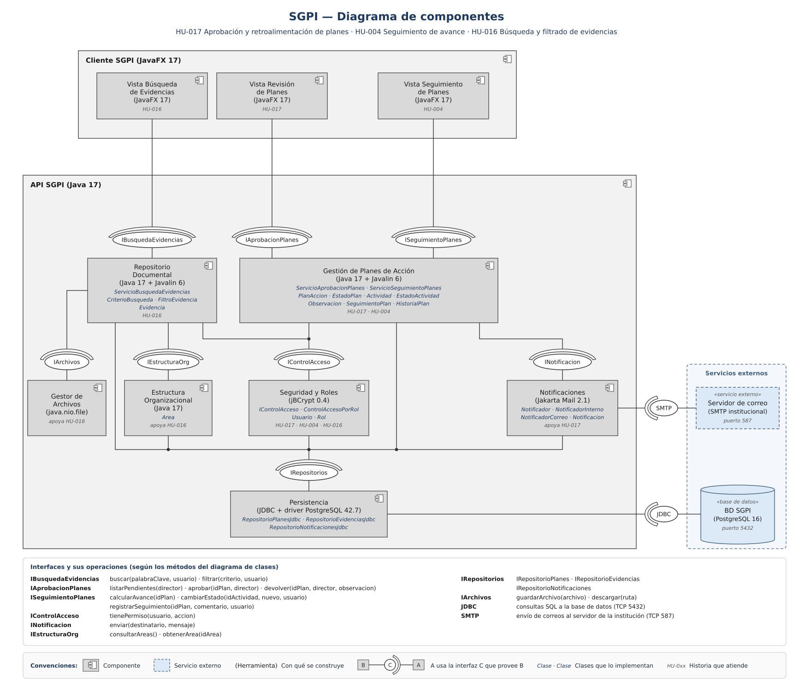

# Diagrama de componentes

| Campo | Detalle |
|---|---|
| Historias de usuario | HU-017 (principal), HU-004 y HU-016 |
| Issue | #68 (sub-issue de HU-017, #25) |
| Fuente editable | [`diagrama-componentes.svg`](diagrama-componentes.svg) (se edita con Inkscape o un editor de texto) |

## Componentes

Cada componente indica entre paréntesis la herramienta con la que se construye, las clases que lo implementan y la historia que atiende.

| Componente | Herramienta | Provee | Requiere |
|---|---|---|---|
| Vista Búsqueda de Evidencias | JavaFX 17 | — | IBusquedaEvidencias |
| Vista Revisión de Planes | JavaFX 17 | — | IAprobacionPlanes |
| Vista Seguimiento de Planes | JavaFX 17 | — | ISeguimientoPlanes |
| Repositorio Documental | Java 17 + Javalin 6 | IBusquedaEvidencias | IArchivos, IEstructuraOrg, IControlAcceso, IRepositorios |
| Gestión de Planes de Acción | Java 17 + Javalin 6 | IAprobacionPlanes, ISeguimientoPlanes | IControlAcceso, INotificacion, IRepositorios |
| Seguridad y Roles | jBCrypt 0.4 | IControlAcceso | IRepositorios |
| Notificaciones | Jakarta Mail 2.1 | INotificacion | IRepositorios, SMTP |
| Estructura Organizacional | Java 17 | IEstructuraOrg | IRepositorios |
| Gestor de Archivos | java.nio.file | IArchivos | — |
| Persistencia | JDBC + driver PostgreSQL 42.7 | IRepositorios | JDBC |

## Servicios externos

Están fuera de la API, en el recuadro punteado azul:

- **BD SGPI (PostgreSQL 16):** base de datos relacional; la Persistencia se conecta por JDBC (puerto 5432).
- **Servidor de correo de la institución:** recibe los correos que envía Notificaciones por SMTP (puerto 587).

## Interfaces

Una línea con bola es una interfaz provista; la media luna es la interfaz requerida por quien la usa. Las operaciones de cada interfaz son los métodos del diagrama de clases y están en el recuadro inferior del diagrama.
