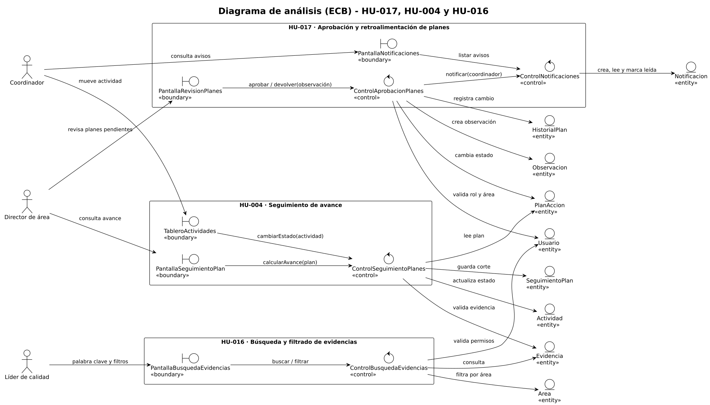

# Diagrama de análisis (ECB)

| Campo | Detalle |
|---|---|
| Historias de usuario | HU-017 (principal), HU-004 y HU-016 |
| Issue | #66 (sub-issue de HU-017, #25) |
| Fuente editable | [`diagrama-ecb.puml`](diagrama-ecb.puml) (PlantUML); la imagen [`diagrama-ecb.svg`](diagrama-ecb.svg) se genera con `java -jar plantuml.jar -tsvg diagrama-ecb.puml` |

## Qué muestra

El diagrama separa, para cada historia, lo que ve el usuario (límite), la lógica que decide (control) y los datos que se guardan (entidad). Los actores son el director de área, el coordinador y el líder de calidad.

| HU | Límite «boundary» | Control «control» | Entidades «entity» |
|---|---|---|---|
| HU-017 Aprobación y retroalimentación | PantallaRevisionPlanes (director), PantallaNotificaciones (coordinador) | ControlAprobacionPlanes, ControlNotificaciones | PlanAccion, Observacion, HistorialPlan, Notificacion, Usuario |
| HU-004 Seguimiento de avance | PantallaSeguimientoPlan (director), TableroActividades (coordinador) | ControlSeguimientoPlanes | PlanAccion, Actividad, Evidencia, SeguimientoPlan |
| HU-016 Búsqueda y filtrado de evidencias | PantallaBusquedaEvidencias (líder de calidad) | ControlBusquedaEvidencias | Evidencia, Area, Usuario |

## Flujos

- **HU-017:** el director aprueba o devuelve un plan desde PantallaRevisionPlanes. ControlAprobacionPlanes valida su rol y área en `Usuario`, cambia el estado del `PlanAccion`, guarda la `Observacion` cuando devuelve, registra el cambio en `HistorialPlan` y le pide a ControlNotificaciones que avise al coordinador, quien ve el aviso en PantallaNotificaciones.
- **HU-004:** el coordinador mueve una actividad en el TableroActividades. ControlSeguimientoPlanes valida que la `Actividad` tenga `Evidencia` antes de dejarla en FINALIZADA, y recalcula el avance del plan (actividades finalizadas / total). El director consulta ese avance en PantallaSeguimientoPlan, y cada corte de seguimiento queda en `SeguimientoPlan`.
- **HU-016:** el líder de calidad escribe una palabra clave o aplica filtros (tipo, fechas, área, responsable). ControlBusquedaEvidencias revisa sus permisos en `Usuario` y consulta `Evidencia` y `Area`; solo devuelve lo que el usuario puede ver.
