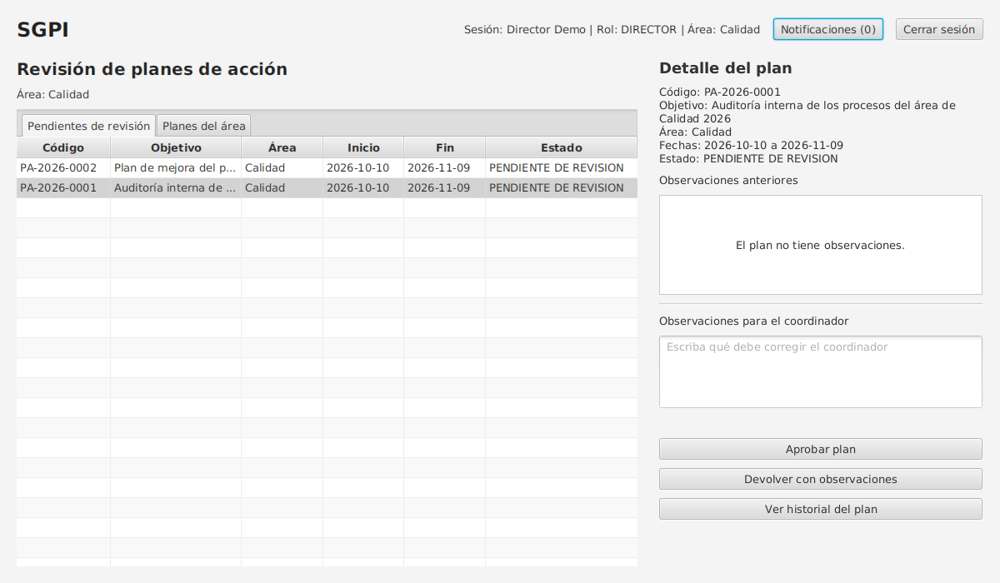
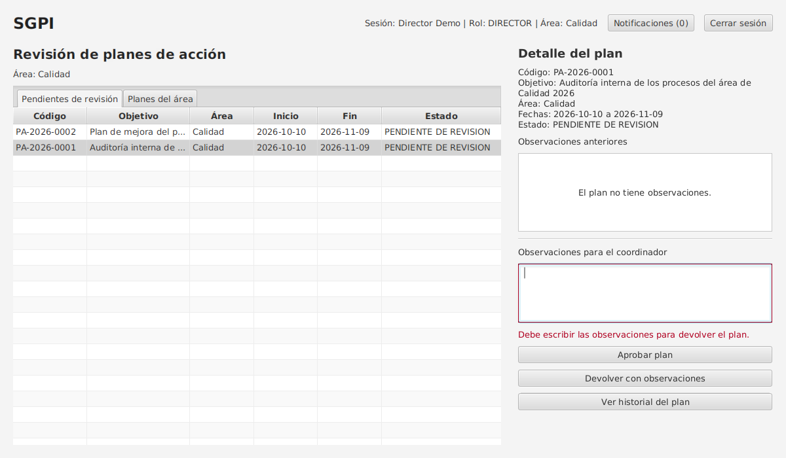
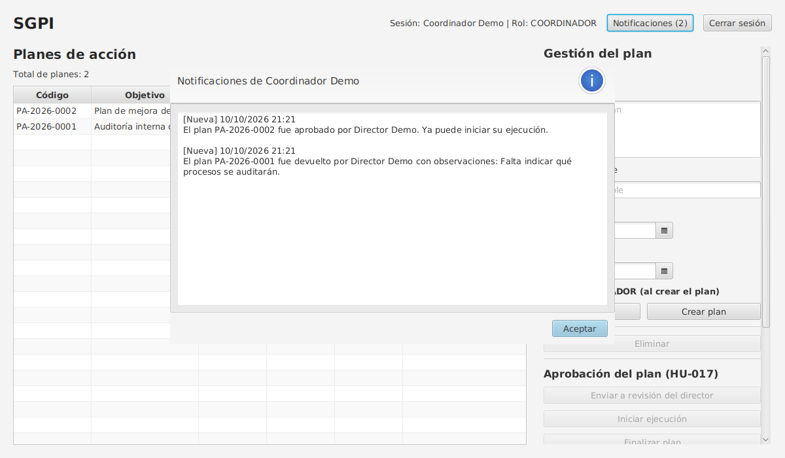
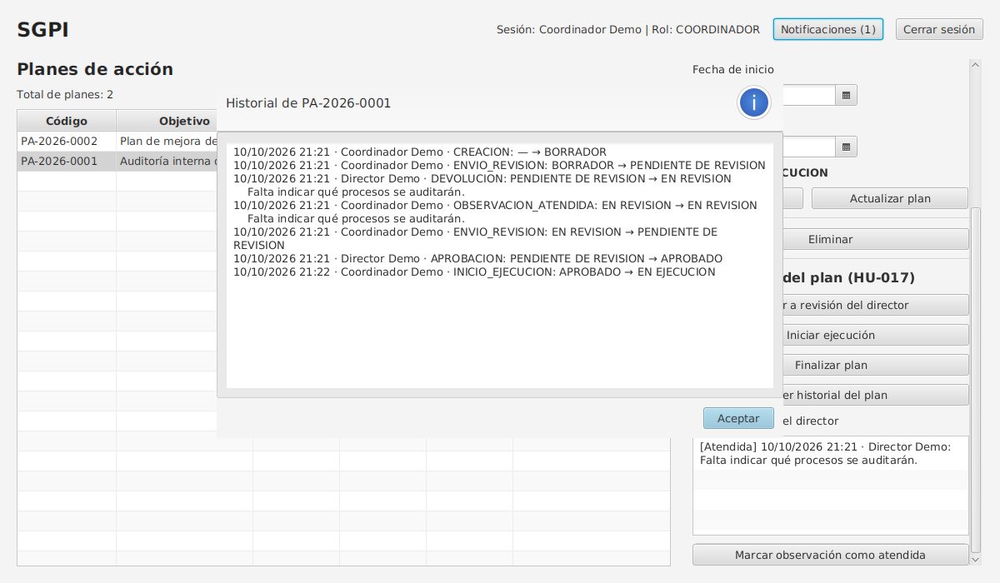

# Reporte Gerencial — Sprint 2

**Gestión y Reportes**
SGPI: Sistema de Gestión de Procesos Institucionales
Grupo Los FIS
Pontificia Universidad Javeriana, Facultad de Ingeniería

> Issue #37. Fuentes: [acta de Sprint Planning](Planning/Acta-Planning-Sprint2.md), [cronograma de desarrollo](Planning/cronograma-desarrollo.md), historial del repositorio, [acta de pruebas del Sprint 2](Calidad/actas/acta-pruebas-sprint-2.md) y [evidencias del prototipo](Calidad/evidencias/evidencias-entrega-2.md).

---

## 1. Identificación

| Campo | Detalle |
|---|---|
| Proyecto | SGPI: Sistema de Gestión de Procesos Institucionales |
| Cliente / Product Owner | Ing. Kerwin Barros |
| Sprint | 2 (23 de septiembre – 7 de octubre de 2026) |
| Fecha del reporte | 10 de octubre de 2026; actualizado el 12 de octubre con la prueba en Maven (CP-PRO-09), la unión del PR #40 y el orden del repositorio; y el 16 de octubre con el diagrama de clases y el modelo relacional |
| Responsable | David Álvarez Rodríguez (Gestión y Reportes) |
| Estado del proyecto | Primer prototipo funcional en JavaFX + H2. HU-017 implementada y unida a `main`; falta la revisión de otro integrante. La arquitectura documentada todavía no coincide con el prototipo. |

## 2. Objetivo del Sprint 2

Según el acta de Sprint Planning del 23 de septiembre, el objetivo era **definir el alcance, el cronograma y la asignación de tareas técnicas, con foco en el diseño arquitectónico, el prototipado de interfaces y la preparación del entorno de desarrollo del SGPI**.

El equipo se comprometió a terminar el diseño técnico el 27 de septiembre y a empezar a programar el 28. Las tareas asignadas fueron:

| Integrante | Tareas del Sprint 2 | HU para programar |
|---|---|---|
| David Andrés Galindo (líder técnico) | Modelo entidad-relación y diagramas UML; configurar el entorno de desarrollo | HU-001, HU-006 |
| Juan Sebastián Martínez (requisitos) | Mockups de login, tablero Kanban y formulario de planes | HU-002, HU-003 |
| David Álvarez (gestión y reportes) | Definition of Done y formatos de actas de pruebas | HU-018, HU-005 |
| Miguel Ángel Gómez (Scrum Master) | Issues del Sprint 2 en GitHub Projects, milestone, gráfico Burn up | — |

## 3. Trabajo realizado

Según el historial del repositorio entre el 23 de septiembre y el 7 de octubre:

| Integrante | Trabajo registrado | Fecha |
|---|---|---|
| Miguel Ángel Gómez | Acta de Sprint Planning del Sprint 2; registro de la daily del día 6 | 23 – 28 sep |
| David Álvarez | Diagramas de componentes y de despliegue con la descripción de la arquitectura (PR #29). Definition of Done, formatos de caso de prueba y de acta de pruebas, y cronograma de desarrollo (PR #30). Acta de pruebas preparada (PR #31). Documentos de la Entrega 1 pasados a Markdown (PR #33 y #34) y corregidos (PR #35). Limpieza de issues duplicados. | 3 – 4 oct |
| Juan Sebastián Martínez | Primer prototipo funcional (PR #36): inicio de sesión con contraseñas cifradas, roles ADMIN, COORDINADOR y RESPONSABLE, creación y consulta de planes, base de datos H2 | 6 oct |
| David Andrés Galindo | No hay commits suyos en el repositorio ni cambios en la Wiki durante el sprint | — |

**Después del cierre (8 – 16 oct), como parte de la Entrega 2:**

- **David Álvarez:**
  - Implementó la HU-017 sobre el prototipo, con 12 pruebas JUnit (PR #40, unido a `main` el 12 de octubre).
  - Ejecutó las pruebas del prototipo y reunió las evidencias. El 12 de octubre corrió `mvn clean test` en Windows: las 12 pruebas pasan (CP-PRO-09).
  - Completó el acta de pruebas y este reporte.
  - Registró las tareas de la Entrega 2 en los issues #25 y #37 a #39, y los defectos en los issues #41 y #42.
  - Ordenó el repositorio (PR #46): quitó la copia de Maven y el script de arranque (#41), agregó el Maven Wrapper, la guía de usuario y el respaldo de la Wiki, y actualizó el README. Abrió el PR #47 para poner `develop` al día con `main`.
  - Subió el diagrama de clases y el modelo relacional con su fuente en PlantUML, corregidos para que coincidan entre sí y con el prototipo (PR #48).

## 4. Trabajo pendiente

| Pendiente | Responsable en el planning | Situación |
|---|---|---|
| Modelo entidad-relación y diagramas UML en el repositorio | David Andrés Galindo | El diagrama de clases y el modelo relacional ya están en `Graficas/`, con su fuente editable (PR #48). Faltan los diagramas de secuencia y de procesos. |
| Entorno de desarrollo base | David Andrés Galindo | No se configuró el entorno Spring + web + PostgreSQL del cronograma. El prototipo usa otro stack (ver sección 7). `develop` tenía solo la estructura de carpetas; el PR #47 la pone al día con `main`. |
| Mockups | Juan Sebastián Martínez | No se hicieron. Las pantallas del prototipo están en las capturas de la Entrega 2. |
| Issues del sprint, milestone y Burn up | Miguel Ángel Gómez | No se crearon issues nuevos durante el sprint. Los issues abiertos siguen en el milestone "Sprint", que venció el 21 de septiembre. |
| Sprint Review y Retrospectiva | Miguel Ángel Gómez | No se han registrado. |
| Daily del día 7 | Miguel Ángel Gómez | No se registró; la del día 6 solo tiene una de las cuatro partes. |
| HU-003, HU-005 y HU-018 | Juan Sebastián Martínez y David Álvarez | Sin programar. |

## 5. Estado de las historias de usuario

| HU | Historia | Responsable | Estado |
|---|---|---|---|
| HU-001 | Login en el sistema | David Andrés Galindo | Avance en el prototipo: inicio de sesión con contraseñas cifradas (BCrypt). Sin casos de prueba escritos. |
| HU-006 | Autenticación y control de roles | David Andrés Galindo | Avance en el prototipo: tres roles con permisos distintos; el PR #40 agrega el rol DIRECTOR. Sin casos de prueba escritos. |
| HU-002 | Registro de un nuevo plan de acción | Juan Sebastián Martínez | Avance en el prototipo: crear, editar y consultar planes, con código único y validaciones. Sin casos de prueba escritos. |
| HU-003 | Carga de evidencias documentales | Juan Sebastián Martínez | Sin iniciar. |
| HU-005 | Notificaciones de vencimiento | David Álvarez | Sin iniciar. El PR #40 agrega notificaciones internas que pueden servir de base. |
| HU-018 | Recuperación de contraseña | David Álvarez | Sin iniciar. |
| HU-017 | Aprobación y retroalimentación de planes | David Álvarez (Entrega 2) | Implementada en el PR #40, unido a `main` el 12 de octubre: sus 4 casos de prueba y las 12 pruebas JUnit pasan, también con Maven en Windows. Queda en *In review*: el PR se unió sin la revisión de otro integrante y falta arrancarlo en Windows (CP-PRO-08). |
| HU-016 | Búsqueda avanzada de evidencias | Asignada a Changostt en el issue #24 | Sin iniciar; depende de HU-003. |

Ninguna HU cumple todavía la Definition of Done completa.

## 6. Indicadores

| Indicador | Resultado | Observación |
|---|---|---|
| HU planeadas para programar en el sprint | 6 | HU-001, HU-002, HU-003, HU-005, HU-006 y HU-018 |
| HU con avance en código | 3 | HU-001, HU-002 y HU-006, en el prototipo |
| HU en *Done* | 0 | Falta revisión de PR y casos de prueba |
| Pull requests unidos en el sprint | 8 | Del #29 al #36, todos directo a `main` y sin revisión registrada |
| Dailies registradas en el sprint | 1 de forma parcial | Día 6 (solo una parte); día 7 sin registrar |
| Casos de prueba ejecutados | 13 | 12 pasan y 1 falla (`develop` desactualizada); 4 no se ejecutaron |
| Pruebas automáticas (JUnit) | 12 | Las 12 pasan, también con `mvn clean test` en Windows; son las primeras del proyecto |
| Defectos registrados | 8 | 6 corregidos (4 en el PR #40 y 2 en el PR #46), 1 en corrección (#42) y 1 abierto (D-07) |

## 7. Problemas encontrados y tratamiento

| Problema | Impacto | Tratamiento |
|---|---|---|
| El prototipo usa JavaFX + H2, mientras que el cronograma, el acta de pruebas preparada y la documentación de arquitectura suponen Spring, frontend web y PostgreSQL | Los documentos no describen el sistema real; los casos de prueba del entorno quedaron sin sentido | Los casos se reemplazaron por casos sobre el prototipo. La revisión de la arquitectura quedó asignada a Galindo para la Entrega 2. |
| Atraso de unos 6 días en el diseño técnico | Las HU planeadas no se programaron en el sprint | Se pasaron al Sprint 3 en el cronograma. |
| El prototipo se unió directo a `main` sin revisión ni issue vinculado, y `develop` quedó atrás | No se cumple la estrategia de ramas del README ni la DoD | Defecto D-08 (#42): el PR #47 pone `develop` al día; falta acordar a qué rama van los PR. |
| El prototipo trae un script que sobrescribe el código y una copia de Maven | Riesgo de perder código y repositorio más pesado | Defectos D-04 y D-05 (#41), corregidos en el PR #46. Maven se descarga con el Maven Wrapper. |
| Inconsistencia en HU-017: el CU-01 dice que un plan devuelto vuelve a "En borrador" y la HU dice "En revisión" | Duda sobre el comportamiento correcto | Se implementó "En revisión", como dicen la HU y los casos; cambiarlo es una línea. Juan Sebastián decide con el equipo. |
| Issues de HU cerrados en la Entrega 1 aunque no estaban programados | El tablero no refleja el avance real | Miguel revisará issues, estados y milestone en la Entrega 2. |
| Registro Scrum incompleto (dailies, Review, Retro) | Poca evidencia del seguimiento del sprint | Miguel completará la Review y la Retro en la Entrega 2. |

## 8. Avances técnicos

- **Primer prototipo funcional** en Java 17 con JavaFX, base de datos H2 por JDBC y contraseñas con BCrypt (Juan Sebastián, PR #36).
- **Flujo de aprobación de planes (HU-017)**, PR #40:
  - Estados controlados: BORRADOR → PENDIENTE DE REVISION → APROBADO o EN REVISION → EN EJECUCION → FINALIZADO.
  - Vista del director de área.
  - Observaciones obligatorias al devolver.
  - Notificaciones al coordinador.
  - Historial de cambios de estado.
  - Reglas validadas también en la capa de datos.
- **Primeras pruebas automáticas** del proyecto: 12 pruebas JUnit 5 sobre una base H2 en memoria, que se ejecutan con `mvn test`.
- **Maven Wrapper** (`mvnw`): el proyecto compila y corre sin instalar Maven.
- **Guía de usuario** del prototipo en `Docs/guia-de-usuario.md`.
- **Esquema de la base de datos del prototipo** documentado en `Database/prototipo-h2.sql`. Las bases creadas con la versión anterior se actualizan solas.
- **Base de calidad:** Definition of Done, formatos de caso y acta de pruebas, y casos de prueba de HU-016 y HU-017.

## 9. Evidencias

**Vista del director con los planes pendientes de su área (HU-017):**

**Devolver sin observaciones: el sistema no lo permite y muestra el mensaje junto al campo (CP-HU017-03):**

**El coordinador recibe la notificación con la observación (CP-HU017-02):**

**Historial de cambios de estado del plan:**

Las 25 capturas y los registros de ejecución están en el [índice de evidencias](Calidad/evidencias/evidencias-entrega-2.md).

## 10. Resultado del Sprint

El Sprint 2 cerró con un **resultado parcial**:
- El diseño técnico quedó a medias: hay diagramas de componentes y de despliegue, pero el modelo de datos y los mockups no están en el repositorio.
- El equipo cuenta con un prototipo funcional que cubre parte de HU-001, HU-002 y HU-006.
- No se cumplió la configuración del entorno Spring + web + PostgreSQL. En su lugar el equipo construyó un prototipo de escritorio con otro stack, decisión que aún no está documentada.
- Ninguna HU llegó a *Done* y el sprint no cumple la DoD de sprint.

La propuesta, registrada en el acta de pruebas, es cerrar el Sprint 2 con el prototipo como resultado parcial y pasar las HU pendientes al Sprint 3.

## 11. Trabajo proyectado para el Sprint 3

**Sprint 3: 8 – 21 de octubre**, según el cronograma:
- 20 oct: congelamiento y pruebas.
- 21 oct: Review y Retrospectiva.

**HU del cronograma para el Sprint 3:**

| HU | Historia | Responsable |
|---|---|---|
| HU-001 | Login en el sistema | David Galindo |
| HU-006 | Autenticación y control de roles | David Galindo |
| HU-018 | Recuperación y restablecimiento de contraseña | David Álvarez |
| HU-008 | Administración y asignación de roles de usuario | Por asignar |
| HU-010 | Gestión de la estructura organizacional | Por asignar |
| HU-002 | Registro de un nuevo plan de acción | Juan Sebastián Martínez |

**Tareas de la Entrega 2 repartidas en el equipo:**

| Integrante | Tareas |
|---|---|
| David Álvarez | Implementación de HU-017 (PR #40); Reporte Gerencial del Sprint 2; acta de pruebas; coordinación de evidencias del prototipo |
| David Andrés Galindo | Diagrama de clases y su fuente editable; revisión técnica del SDD frente al código real; revisión de los diagramas de secuencia y procesos; identificar los patrones que existen en el código |
| Miguel Ángel Gómez | Sprint Review; Retrospectiva; seguimiento de issues, responsables, estados, milestone y tablero |
| Juan Sebastián Martínez | Corregir la inconsistencia de HU-017 y CU-01; trazabilidad entre requisitos y diseño; revisión de los casos de prueba de HU-016 y HU-017; documentar los patrones en el SDD |
| Todo el equipo | Diagrama de secuencia alrededor de HU-017 (Galindo revisa); diagrama de procesos (David y Juan Sebastián definen el flujo funcional, Galindo valida) |

**Riesgos para el Sprint 3:**
- Que la arquitectura documentada siga sin coincidir con el prototipo.
- Que los PR se sigan uniendo sin revisión, lo que impide cumplir la DoD. El PR #40 también se unió sin revisión de otro integrante; su revisión queda pendiente.
- Que no se pruebe el arranque del prototipo en Windows (RNF-08, CP-PRO-08), que es la plataforma del comando de ejecución del README. La compilación y las pruebas con Maven ya pasan en Windows.
- Que el atraso del Sprint 2 se acumule con las HU del Sprint 3.
